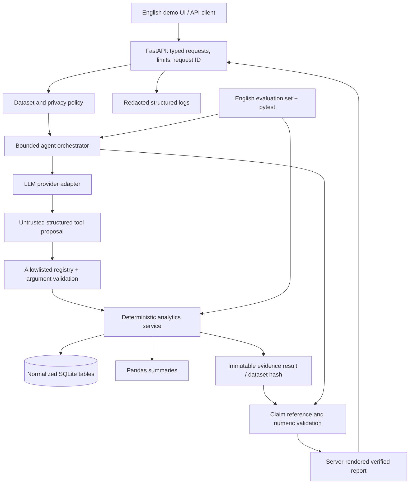

# Academic Analytics Copilot — implementation proposal

Status: **independent-build approach accepted; first core/API increment implemented and tested**.
Actual progress: [development/01-core-api.md](development/01-core-api.md). Remaining agent/UI/delivery sections below describe the target design, not completed features.
The current user requirements supersede the original CSV-only/UI choices: support CSV and XLSX import, and use a Streamlit client connected to FastAPI. The first increment implements the importer and backend; the Streamlit client remains next.
Prepared for an SAP STAR Application Engineer (2028 Graduates) portfolio.
The upstream audit is the decision gate. Review `audit/UPSTREAM_REVIEW.md` before accepting this plan.

## Decision and scope

Build an independent application in this repository. Retain the upstream attribution and MIT notice as reference provenance. Reuse the dashboard's analysis ideas (distribution, comparison, correlation), rather than its monolithic script, CSV heuristics, model, data or prediction logic. No SAP integration or SAP endorsement is claimed. The engineering evidence should demonstrate API design, relational modeling, controlled LLM integration, debugging and delivery.

Use a single backend service, SQLite for a local demonstration, Pandas for descriptive analytics, typed request/result models, and a small English demo UI served by the backend. Avoid a separate frontend build and an agent framework initially: a small explicit state machine is easier to explain and test. A hosted LLM is an optional provider behind an adapter; a scripted provider supports deterministic offline tests and must be labeled as simulated. Live provider behavior is a separate verification track.

## Architecture

Treat model text, tool arguments, questions, filenames and cell values as untrusted input. Only the application owns tools, database handles and evidence. There is no Python execution tool, SQL tool, shell tool or user-supplied tool URL.

## A–J requirement mapping

| Requirement | Planned module | Acceptance evidence |
|---|---|---|
| A. FastAPI backend | `src/copilot/api/`, `schemas/` | OpenAPI, request/response validation, real HTTP smoke and TestClient tests |
| B. Pandas/SQL analytics | `analytics/`, `storage/` | Typed fixed queries with bound parameters; Pandas/SQL parity on explicit fixtures |
| C. LLM API integration | `llm/provider.py`, `llm/live.py`, `llm/scripted.py` | Configured hosted request with timeout and redaction; live smoke separated from scripted tests |
| D. Controlled function calling | `agent/registry.py`, `agent/orchestrator.py` | Unknown tools, extra fields, bad filters and SQL/Python requests rejected before dispatch |
| E. Structured outputs | `schemas/tools.py`, `schemas/reports.py` | Strict JSON schema; typed refusal, clarification and report variants; extra fields forbidden |
| F. Grounded numerical validation | `validation/claims.py`, `reports/render.py` | Every displayed quantitative claim resolves to a computed metric, scope and dataset version |
| G. Prompt evaluation | `evals/questions.jsonl`, `evals/runner.py` | At least 30 English questions, traces, independent correctness checks, failure analysis |
| H. Unit/API tests | `tests/unit/`, `tests/api/`, `tests/integration/` | Recorded commands, exit codes and results; mocked and live boundaries identified |
| I. Structured logging | `observability/logging.py` | JSON request/tool/validation events; tests prove no secrets or student rows in logs |
| J. Docker/documentation | `Dockerfile`, `.dockerignore`, `compose.yaml`, `docs/` | Non-root image, healthcheck, build/run records, setup/demo/debug/interview guides |

This is the target module map. Implemented first-increment modules use a smaller layout under `src/copilot/`; the development record maps the actual files. Agent, UI, evaluation runner and container artifacts remain planned.

## Normalized synthetic data contract

Use one academic term (`2026-T1`) to keep the first demonstration clear. Create data locally with a fixed seed (`20261103`), a pinned generator version and pinned dependencies. Store a manifest with seed, counts, schema version and sorted-export SHA-256 hashes. Generate neither real identities nor adaptations of historical college records. Identifiers and display names should visibly indicate simulation, e.g. `S0001`, `Synthetic Student 0001`.

| Table | Keys and fields | Constraints |
|---|---|---|
| `classes` | `class_id` PK, `grade_level` (1–3), `class_label` | 40 classes; grade exists only here for each student's current class |
| `students` | `student_id` PK, `class_id` FK, `display_name` | 1,382 students; one current class; no email, address or contact fields |
| `courses` | `course_id` PK, `course_name`, `grade_level`, `credits` | 96 catalog courses; 32 per grade; 2–4 credits |
| `enrollments` | `enrollment_id` PK, `student_id` FK, `course_id` FK, `term` | Unique student/course/term; grade eligibility validated |
| `grade_records` | `grade_record_id` PK, `enrollment_id` unique FK, `status`, `score_cents` | One final record per enrollment; integer 0–10,000 for graded records; NULL for missing/exempt |

Planned class allocation: grade 1 has 14 classes (8×35 + 6×34 = 484 students); grades 2 and 3 each have 13 classes (7×35 + 6×34 = 449). Total: 40 classes and 1,382 students. These are design counts, not claims about generated files.

Within each grade's 32-course catalog, define eight core courses and 24 electives. Every student takes eight core courses plus two to four distinct electives: **10–12 courses per student**, all within the student's grade. Balance elective assignments so every catalog course has enrollment. This creates 13,820–16,584 enrollments, rather than a 1,382×96 score matrix. Exact enrollment, missing and pass counts must come from the generated manifest. Use bounded score distributions with student/course variation and an explicitly documented small missing-record rate; synthetic patterns establish no real-world causal claims.

Enable foreign keys; insert each dataset transactionally; validate duplicate IDs, orphan records, course eligibility, counts and score/status consistency before activation. Sorting and decimal serialization must be canonical for repeatable hashes. A golden dataset hash is established only after the generator actually runs.

## Metric definitions before implementation

- Score units: store hundredths of a point as integers. Use integer sums/counts and Decimal for final display; round half up to two decimal places.
- A graded record passes at `score_cents >= 6000`. Pass rate = passed graded records / all graded records in the selected scope. Return numerator, denominator and missing count. A zero denominator yields `null` with an explanation.
- “Average score” defaults to an unweighted mean over graded enrollment records. If a question implies a student mean, class mean or credit-weighted mean, explicitly label the different metric; ask for clarification if ambiguous. Credit-weighted means use integer weighted sums and total graded credits.
- Missing/exempt records contribute to enrollment/completeness counts and never become zero scores or passes. Student failure count means distinct students with at least one graded score below 60, never failed-enrollment count.
- Comparisons require the same term and metric definition; display sample sizes. Overall cross-grade averages are descriptive because catalogs differ. Do not infer teaching quality or causation.
- Correlation uses students taking both specified courses, paired complete observations, sample size and a minimum sample rule. Never invent zeros for untaken courses. Low-count cells and constant scores return “insufficient data”.
- Ties use explicit stable secondary keys. Report an eligible population and requested limit. Do not rank by total points across different course loads.

## Controlled agent and numerical grounding

Start with six read-only tools: `get_dataset_overview`, `get_course_summary`, `compare_classes`, `get_grade_summary`, `get_failure_summary`, `get_score_distribution`. Each tool accepts only typed IDs/enums, a term, bounded limits and declared filters. Course correlation can be a later seventh tool after paired-enrollment tests. No arbitrary column names, expressions, paths, SQL strings, URLs or code arguments are accepted.

The state machine is: validate request → check privacy policy → request structured tool proposals → validate and dispatch → register evidence → request structured claim references → validate → render. Cap at four model turns, six tool calls and an overall timeout; reject unknown tool names and unsupported arguments; permit at most one schema-correction retry within the same limits. Provider timeout/rate limit/refusal returns a typed error or deterministic report fallback. Never silently present a scripted response as a real LLM run.

Each tool result carries `evidence_id`, `dataset_version`, tool/schema version, normalized arguments, scope, metric names, raw exact numerators/denominators, display values and units. The server stores this evidence for the current request; the model cannot create it. A report claim contains only `evidence_id`, an allowlisted metric path and a permitted comparison/template operation. Validate references, scope, units, rounding, denominators and arithmetic; reject fabricated or mismatched references. Derived differences are deterministic server operations over compatible evidence.

Render all formal quantitative sentences and tables on the server from verified references. Model prose must not introduce free-form quantitative claims: confine it to enumerated narrative templates and clearly separated qualitative suggestions. Dates, grade IDs and course IDs belong in typed fields, not a regex-based “number detector.” On validation failure, return a verified deterministic fallback with a validation status. Schema-valid JSON alone does not establish factual correctness.

Example future tool call: `get_course_summary({"course_id":"G1-C01","term":"2026-T1"})`. The question's actual course ID must be resolved from a controlled local catalog. A later report claim references the server-issued result; the model never supplies its own average or pass count.

## Upload and privacy policy

For the first demo, public hosted LLM usage is allowed only for the application's own generated synthetic dataset. Merely checking a user's “synthetic” checkbox cannot prove provenance. Imported files remain local-only; hosted analysis of them is disabled. Local structured filter APIs continue to work. Free-text questions are also an exfiltration channel: use a restricted synthetic-domain question policy with opaque IDs and a local planning step; do not forward raw uploaded records, names, raw logs or unrestricted user text to a provider. An external call receives a canonical sanitized intent, synthetic catalog IDs and aggregate evidence only. Provide a visible synthetic-data banner and an external-provider indicator.

Accept one explicitly selected normalized table as UTF-8 CSV per upload, without archives or Excel files in v1. Apply a proposed 5 MiB streaming cap, MIME/extension checks plus actual CSV decoding/parsing, exact headers, bounded rows/cells/field lengths, duplicate-header detection before normalization, type/range/status checks and relational constraints. Reject NULs, invalid encodings, path traversal names, binary/pickle/model content, NaN/Infinity and unsupported fields. Never use client filenames as storage paths. Load to staging and validate all five tables before atomic dataset replacement. Escape exported spreadsheet formula cells and UI text. MIME alone is insufficient validation.

Use loopback binding for the local demo. Any public deployment requires an explicit authentication/rate-limit and dataset-access design before exposure. Keep API keys in environment variables, never in fixtures or Git. Logs contain request ID, dataset hash, tool name, sanitized ID filters, result digest, latency, provider/model identifier, token usage if supplied, error category and validation outcome. Exclude raw questions, record rows, prompt bodies, authorization headers and keys. Tool traces retained for evaluation contain only synthetic fixtures and undergo redaction checks.

## Delivery sequence and learning record

| Module gate | New files (planned) | Core knowledge and tradeoff | Required verification / record |
|---|---|---|---|
| 0. Audit (current) | Audit scripts, evidence, upstream review, this plan, notice | Code/license review; reproducible snapshot; bounded dynamic checks | Record actual installation, static scan, probes and their limits; decide reuse before product changes |
| 1. Data and storage | `data/generate.py`, `storage/`, dataset manifest, schema tests | Normalization, PK/FK/uniqueness, seed determinism; SQLite keeps setup small | Exact counts, 10–12 enrollments/student, course coverage, byte-repeatability, invalid FK/score rejection |
| 2. Analytics and API | `analytics/`, `schemas/`, `api/`, unit/API tests | Aggregation scope, missingness, HTTP validation, bound SQL parameters | Hand-calculated fixtures; SQL/Pandas parity; denominators; 200/413/415/422 errors; request correlation |
| 3. Controlled agent | Registry, orchestrator, scripted/live adapters | Untrusted model outputs, state budgets, schema validation; explicit loop over framework | Unknown-tool and injection rejection; timeout/retry/refusal; no code/SQL tool; sanitized outbound payload capture |
| 4. Report verification | Evidence registry, claim validator, renderer | Grounding and rounding; template restrictions trade prose freedom for verifiability | Deliberately wrong numbers/scopes/evidence IDs blocked; 100% quantitative claim coverage; deterministic fallback |
| 5. Evaluation and UI | English cases, evaluation runner, small demo UI | Independent oracle vs model trace; offline/live separation | ≥30 cases; per-case outcomes and traces; regression failures documented; a real hosted call tested separately if configured |
| 6. Packaging and explanation | Docker/Compose, CI, English README, diagrams, walkthrough | Reproducible delivery; secrets/logging; process debugging | Full pytest and HTTP smoke; build/run/healthcheck in actual Docker; no “verified” badge for unrun checks |

After each module, add `docs/development/NN-module.md` with: files added/changed; knowledge learned; design decisions; exact commands/environment; observed pass/fail/skip counts; original failure; root cause; fix; re-run evidence; remaining limitations. Commit coherent completed modules to Git. Do not mark future acceptance criteria as passed. A defect seen in upstream should first become a meaningful regression scenario in the new architecture, rather than a patch to the archived reference.

## Portfolio and interview deliverables

English README will distinguish the user's prior experience analyzing records for 1,382 students and 40 classes from this project's entirely synthetic demonstration. It must distinguish upstream authorship from all new implementation, and measure only work actually completed. Do not claim real student data, model accuracy, production usage, live LLM evaluation, SAP connectivity or business impact that has not been demonstrated.

Deliver a runnable local demo, an architecture diagram, normalized data ER diagram, evaluation report with failures, unit/API test record, Docker artifacts, API examples and a five-minute English walkthrough. The walkthrough should follow one question from HTTP request through validated tool arguments, deterministic result, evidence reference and rendered report. Include debugging exercises: 422 input error, wrong denominator, invalid tool call, provider timeout and fabricated report claim. The owner should be able to reproduce the result and explain the design without the coding assistant.

## Acceptance gate

The independent implementation was accepted. Data generation, normalized storage, CSV/XLSX import, deterministic statistics and the basic FastAPI service now have execution evidence in the first-increment record. Hosted LLM integration, the Streamlit client, Agent evaluations and Docker verification remain future work.
