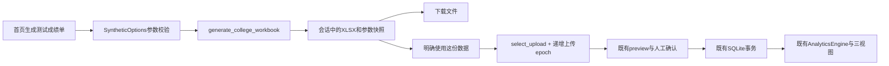
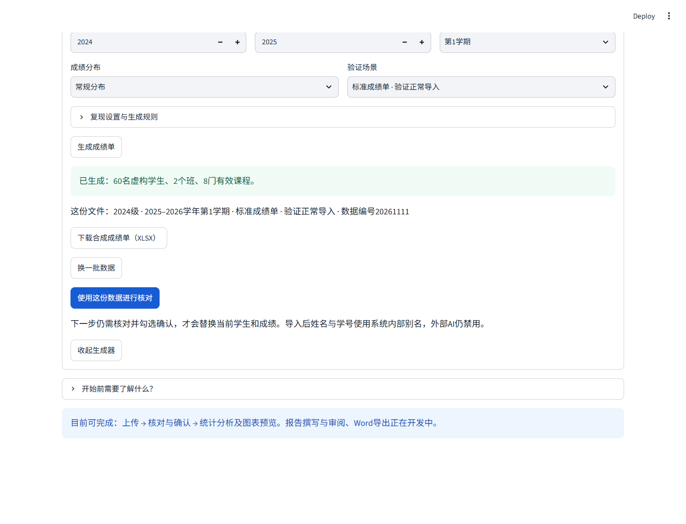

# 可配置合成成绩生成模块

交付日期：2026-11-11。新增本地生成模块，自动产生带合成标记的中文姓名、SIM学号、班级、课程及成绩，用于交互验证现有导入和Dashboard。

基线为`9a5bc4b40f4c336ca33e5f4a9ed4868a33d0d80f`。开始前仅用户原有`docs/development/results/14-deepseek-offline-demo.json`未提交，本轮保持原样。没有读取真实成绩单或IDE中的核对记录；没有新增依赖、模型调用、数据库结构或统计公式变更。

## 页面怎么使用

在上传首页点击**生成测试成绩单**，设置人数、班级、专业、课程、学年学期与成绩分布，再点击**生成成绩单**。

生成后可以：

- **下载合成成绩单（XLSX）**：文件含虚构姓名和学号，可直接打开核查。
- **换一批数据**：自动更换数据编号并立即生成；原先已确认的数据保留。
- **使用这份数据进行核对**：进入既有核对页。仍需勾选确认并点击“确认数据并进入分析”，才替换当前数据。

参数改变后，旧文件下载和使用按钮会禁用，必须重新生成。返回上传页或收起再打开会保留设置；跨阶段返回不应被旧上传控件覆盖。原有6人固定示例与旧命令行批量生成器保留。

默认生成**2024级软件工程、2025–2026学年第一学期、2班×30人、8门课、480条数值成绩**。可选择软件工程、计算机科学与技术、网络工程；每专业1–4班、每班1–50人、3–12门有效课程，最多600学生/7200个活动成绩单元格。当前核心只接受20xx学期，故学年起始年限定2000–2099，并不能早于入学年。

## 成绩与验证场景

姓名由常见中文姓和名字组合，带“合成·”前缀；学号以SIM开头，含年级、专业代码、班序和学生序号。全表姓名/学号唯一（冲突场景故意重复），不取用任何真实名单。

课程池含高等数学(I)-1、Web技术基础、工程实践2、体育III、Python程序设计、大学英语、数据结构、数据库、计算机网络等；表头保留类别、修读性质、学分、学时与学期，包含小数学分。采用单成绩工作表和复合表头，直接进入已有Excel Adapter。

分数依据虚构的整体水平、班级差异、学生能力、课程难度和随机波动生成，限制0–100并保留两位小数。三个档位为“常规分布 / 整体较好 / 需要关注”。这是明确的合成启发式，不代表真实培养方案或真实成绩分布；不保证固定及格率。

| 场景 | 文件内容 | 预期核对行为 |
|---|---|---|
| 标准成绩单 | 每人每门活动课程都有数值成绩 | 可核对确认，观察分布、均分与及格率 |
| 边界与异常 | 保证0、59.99、60、79.99、80、100；另有空白、缺考、免修、待核验，以及新增一列全空课 | 保留0和临界值；跳过空白/全空列；明确状态单列，未知状态提醒并排除 |
| 重复学号冲突 | 追加同学号、不同班级的一行 | 默认阻止提交，只有人工明确选择后重新预览才可确认 |

边界场景至少2人，且人数×课程数至少10，以容纳全部验证值；不会偷偷增加配置人数。默认边界场景为60名唯一学生、9课程列（8有效+1全空），476条数值、1缺考、1免修、61空白、1未知状态，导入478条记录。冲突场景为61源行、60唯一学生，默认阻止导入；清洗取舍后数量取决于人工策略。

## 可复现与统计边界

“复现设置与生成规则”中的**数据编号**就是随机种子。同编号、同参数，在相同生成器和依赖版本下可得到相同XLSX字节；“换一批数据”递增编号。工作簿的生成时间和ZIP条目时间被规范化，避免仅因文件时间不同而无法比较。跨版本不承诺二进制一致。

生成器的summary记录从源矩阵累计的数量、分数总和和参数，用作独立测试期望；它不调用Adapter或AnalyticsEngine来制造自己的“预期结果”。页面确认后展示的统计仍完全来自既有AnalyticsEngine，不是生成器给出的数字。

末尾课程门数、不及格门数和平均分仅为合成Excel展示；原Adapter仍忽略这些汇总列并独立校验。已有课程目录在导入后保留，因此数据库总课程数可能大于本次活动课程数，应比较本次导入计数和当前报告课程，而不是混用目录总数。

合成文件经上传路径提交后仍标记`uploaded_local_only`，姓名/学号转换成内部别名，外部AI继续禁用。`source="example"`只是页面来源标签，不代表放宽后端权限。生成和下载不读写数据库，也不改动当前已确认报告；只有明确使用后，旧报告/上下文/草稿才失效，最终仍需确认提交。

## 关键代码与调用链



1. **可复现而不影响别的随机调用。** `random.Random(options.seed)`是局部实例，生成姓名和分数不改变全局随机状态。`_stable_xlsx()`只规范化自产文件的包时间与属性时间，不改成绩内容。
2. **生成与激活分开。** `synthetic_result`和`synthetic_generated_options`独立保存；只有配置快照一致，才允许使用文件。`select_upload(...source="example", force=True)`只在明确使用时执行，继而复用现有确认边界。
3. **保存表单与工作流是不同状态。** Streamlit离开页面后会移除未渲染widget key，所以另存`synthetic_form_values`，返回时恢复。递增`college_upload_epoch`防旧上传值将刚生成的数据覆盖。测试不仅查看字段，还实际模拟旧上传控件返回上一批内容。

## 验证与交付边界

独立生成器12项测试涵盖字节复现、不同编号、三专业元数据、原矩阵计数、异常与临界值、冲突策略、参数范围、600人上限、SQLite/AnalyticsEngine的独立预期比对及去身份化。

9项新增页面测试涵盖生成/下载不写库、离线生成、参数变化禁用旧文件、换批、明确核对/确认、原统计版本和AI限制、异常冲突、跨导航状态及参数恢复。与已有45项合跑54项通过；进一步补强的测试包含在最终完整回归。

实际浏览器使用隔离Edge、临时空库和合成数据，检查生成默认数据不激活数据库、实际XLSX下载、进入核对且要求勾选确认、60人/8课/480成绩进入现有统计，以及返回后换批不覆盖已确认数据。自建进程已停止，无外部页面请求或付费模型调用。

完整最终测试结果与源文件Hash见`results/synthetic-generator/`。所有测试使用合成数据；未验证真实成绩分布拟合、完整真实培养方案、多学期合成、超过600人的性能、多人共享会话或本轮新增模块在所有移动设备上的显示。它是按需生成后立即验证的工具，不是后台持续覆写数据的实时任务。

| 实际执行 | 结果 | 回执 |
|---|---|---|
| 生成器独立验证 | 12 passed，1.58秒 | generator.xml |
| 新页面与既有UI回归 | 54 passed，1条既有警告，43.89秒 | ui.xml |
| 补强导航恢复断言后 | 9 passed，11.39秒；最后旧上传值模拟单项1 passed，3.70秒 | panel.xml、stale-upload.xml |
| 最终完整回归 | **382 passed，0失败/跳过，1条既有警告，78.17秒** | full.xml |
| 实际桌面Edge | **5/5通过，4张截图**；源码不变，自建服务停止 | browser.json |

以上有重叠，不能把数量相加。原361项保留，新增12项生成器和9项页面验收。既有警告来自Starlette/httpx TestClient弃用提示。实际命令如下（`python`为项目`.venv/Scripts/python.exe`）：

```powershell
python -m pytest tests/test_synthetic_college.py -q -p no:cacheprovider
python -m pytest tests/test_synthetic_panel.py tests/test_workflow_ui.py tests/test_college_dashboard.py tests/test_dashboard.py -q -p no:cacheprovider
python -m pytest -q -p no:cacheprovider --basetemp=.test-tmp-synthetic-full --junitxml=.audit/synthetic-generator/full.xml
# 浏览器脚本随审查包附带，先按本机路径调整
python synthetic_browser_check.py
```

本轮没有发现产品断言失败。复核了Streamlit跨阶段移除widget键的行为，用独立表单快照恢复；检查了默认值/Session State工程警告，没有在页面复现。已有学期契约只支持20xx，生成参数据此收窄，没有为测试数据改动业务模型。



本轮按生成核心、页面集成、文档与证据作小步提交。完整基线/current源码、累计diff、逐提交patch、文件清单、新源码跟踪状态及用户原有工作区差异会单独导出。真实XLSX、数据库、`.import-history`、密钥、`.env`和私有日志继续排除；仅在单独下载区域提供明确标记的虚构XLSX样例。

实现提交为`9a26a68`（生成核心）与`0f66eef`（页面集成），交付文档另作第三个本地提交，完整SHA由导出manifest固定。见[逐文件清单](synthetic-generator-review/FILES.md)与[新增源码跟踪记录](synthetic-generator-review/UNTRACKED-SOURCES.txt)。
