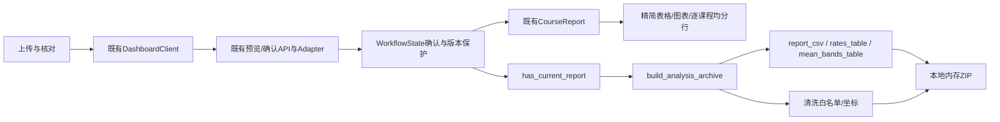
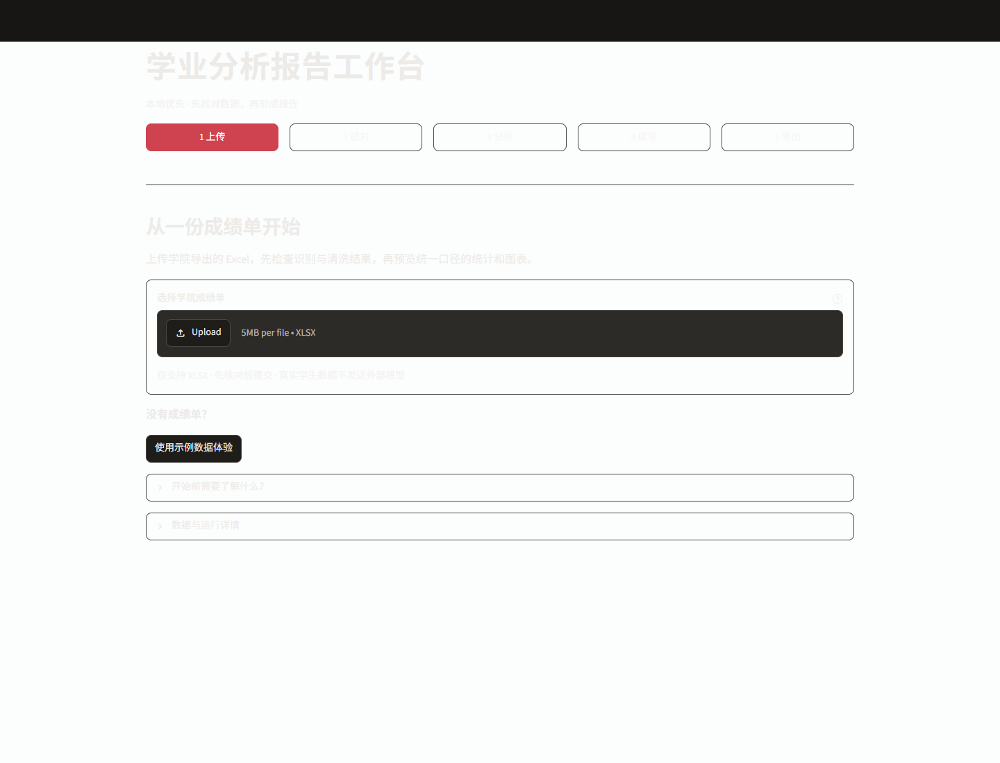
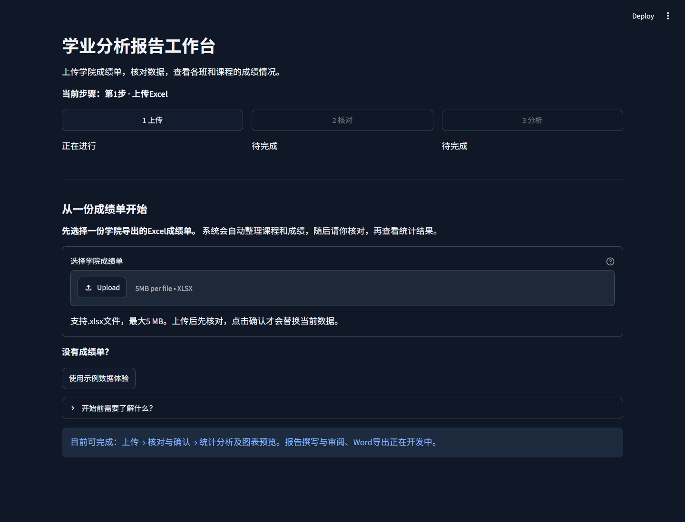
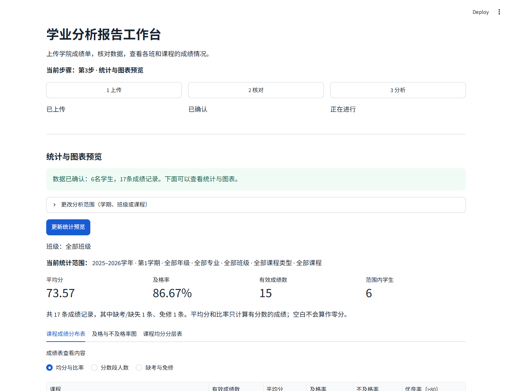
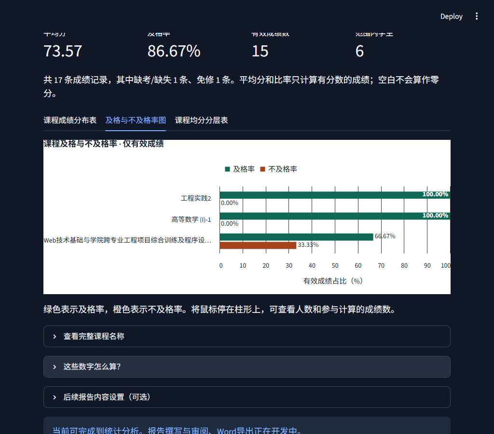

# UX Audit & UI Usability Improvements

交付日期：2026-11-11（Asia/Shanghai）。回执保留各次实际执行时间。

本轮面向第一次使用系统、没有编程基础的学院学生会工作人员，改进可读性、操作引导和信息层级，并提供本地聚合明细ZIP。前三步可用，报告撰写与审阅、Word导出仍在开发中。

基线：`268e094b29c49166af10c355d9c1893959f3943f`。修改前已记录Git状态，只有用户原有`docs/development/results/14-deepseek-offline-demo.json`未提交；本轮保持原样，不纳入功能提交。没有读取IDE中打开的真实核对记录或成绩单；验证全部使用合成数据、隔离数据库和Mock。没有改动数据库、AnalyticsEngine、Excel Adapter解析规则或Agent核心，没有新增框架或依赖，没有付费模型调用。

## 修改前的UX问题与处理结果

| 优先级 | 自查发现 | 本轮处理 |
|---|---|---|
| P0 | 硬编码浅色背景与深色主题浅色文字冲突。真实Edge基线深色标题对比度仅1.17:1，浅色13.46:1 | 删除固定背景，原生配置分别定义深浅配色；图表使用独立白色绘图区和明确的高对比文字 |
| P1 | 关键范围、分母和下一步说明大量使用小号灰字 | 基础字号18px；标题缩为适合办公应用的层级；关键说明用正文；辅助文字继承主题颜色 |
| P1 | 五个同等级按钮没有当前/已完成/待完成说明 | 保留三个可执行步骤，明确当前步骤和完成状态；未来两步用“开发中”文字说明 |
| P1 | 主要按钮“进入撰写”通往未实现功能 | 去掉该按钮及未开放步骤按钮；核对以确认导入为主，分析以更新统计为主 |
| P1 | 六个筛选和两个多选占据首屏，结果藏在下方 | 范围选择折叠；先呈现统计与三种视图；后续内容配置移到结果之后并折叠 |
| P1 | 课程表14列以上，均分矩阵长文本挤在单元格 | 课程表按三种阅读模式分列；均分按课程逐行展示后端分组；课程列加宽，长名另可展开全文 |
| P1 | JSON、版本和会话字段分散在多个详情入口 | 普通工作流不再展示JSON；统一到次要的“下载完整分析与数据明细”入口 |
| P1 | 连接、超时、版本变化仍使用英文及技术词 | 中文解释发生了什么、数据是否保留、如何重试；保留原错误码及请求标识供程序使用 |
| P1 | “默认全部数据”可能让多学期文件被误认为已全部汇总 | 明确说明当前所选学期，展示实际范围；统计逻辑不变 |
| P2 | 统计范围只写“已选班级”，不显示班名 | 分析页显示当前实际班级名称 |
| P2 | 图表标签字体小，深色主题上的深色数字难辨 | 坐标/图例14–15px、标题17px；柱内白字配深色柱形；显式绘图区配色不依赖主题切换时机 |
| P2 | 重复说明及原件、历史JSON等下载入口容易混淆 | 精简为核对所需说明、课程清单和统一聚合明细下载；原件与本机档案仍保留 |

P0是在冻结基线源码中实际重现的缺陷。其他项来自源码、页面流程和基线截图自查；没有把静态推测当成用户调研结果。

## 修改前后如何操作

修改前：上传 → 核对多处说明与详情 → 确认 → 先面对范围/内容/章节选择 → 向下寻找数字 → “进入撰写” → 看到未实现提示。

修改后：

1. 首页直接说明用途、支持的文件和当前可完成的三步，上传入口位于中央，示例为次要入口。
2. 核对人数、课程及成绩记录，按明确提示解决问题，勾选后点击“确认数据并进入分析”。阻止项存在时不能提交。
3. 导入成功后查看当前班级、范围、人数及图表。需要缩小范围时展开选择，再点击“更新统计预览”。
4. 需要留档时展开“分析资料与明细下载”。报告撰写和Word导出明确标为开发中，没有伪装成可执行操作。

返回上传/核对保留确认和统计。筛选变化先撤销旧报告、上下文和下载入口，更新成功才恢复。数据版本或来源变化仍要求重新核对。整页刷新会重置会话、回到上传，已确认本机数据与私有档案保留；本轮没有增加跨会话恢复。

## 展示层的最小改动

`.streamlit/config.toml`使用已安装Streamlit 1.67支持的原生主题配置：18px基础字号、分级标题、浅/深背景和文字、表头颜色。保留主题选择能力，没有添加字体网络请求或前端框架。CSS仅约束阅读宽度和辅助文字，不覆盖应用背景或大面积重写组件。

主页面不再额外展示数据Hash、档案ID、完整时间戳、内部结构或报告上下文JSON。原生上传控件仍显示所选文件名供用户核对。系统离线时仍提供折叠的启动帮助，普通提示先说明如何联系负责启动系统的同事和重试。

成绩表在“均分与比率 / 分数段人数 / 缺考与免修”间切换，只投影同一份数据，不重算统计。课程均分仍使用后端已经分好的区间，展示为一课一行，避免长课程列表挤在矩阵中。表格内部允许滚动；长课程名可展开查看全文，图表悬停也保留完整名称。

原有独立Agent调试组件继续保留回归测试，它不在工作人员主工作流中。本轮没有开放真实数据AI访问。

## 完整分析与数据明细包

在分析结果下方的折叠区点击**下载完整分析与数据明细**，浏览器下载`学业分析与数据明细.zip`。在内存中生成，不读取原件档案、不写库、不调用模型、不使用跨会话全局缓存。

```text
README.md                       阅读方式、范围与隐私边界
report/
  scope.json                    数据版本、当前范围、报告生成时间
  statistics.json               当前范围完整课程聚合统计
  metrics.json                  指标定义与计算口径
tables/
  courses.csv                   完整课程成绩分布、均分、比率与计数
charts/
  rates.csv                     及格/不及格率图对应的数据
  mean_bands.csv                课程均分分层表对应的数据
cleaning/
  summary.json                  整次确认导入的清洗计数与假设
  issues.csv                    异常类别、级别和原表行列位置
verification.json               本次导出一致性检查及文件哈希
```

统计和图表只包含当前筛选范围。清洗记录来自整次已确认导入，文件内明确标注，不能把它当成筛选后某班级的异常数。原解析器异常明细有条数上限，遗漏数量也会记录，不声称导出了被解析器省略的内容。

异常只导出白名单分类、级别和坐标，不导出原始message或单元格值。排除原件、学生行、预览样例、原姓名/原学号、原文件名、令牌、原件Hash、档案ID、会话历史、环境变量和内部Trace。CSV防范公式文本，无法计算的比率保持空值/`—`，JSON保持null。

此包保留课程名称、课程级聚合结果和用于核对的数据标识，适合当前本地使用权限；它不构成向外部AI发送数据的授权，也不是通用个人信息检测器。

## 关键代码调用链与学习记录



**1. 详情隐藏不等于删除证据。** 普通界面只留业务说明，`build_analysis_archive(state)`在同一个报告对象上生成CSV/JSON。`report_csv`等投影直接复用；页面拆列和矩阵改行都不能另写均分或分层公式。

```python
if not state.has_current_report:
    raise WorkflowError("请先确认成绩单并更新当前范围的统计，再下载完整明细。")
```

这项检查沿用工作流的确认、来源、版本及完整范围保护。按钮隐藏是交互层，函数拒绝过期状态是正确性边界。不能只凭屏幕上还存在旧按钮就提供旧文件。

**2. 导出使用白名单，避免“删除几个字段后全部打包”。** 清洗信息只读取已知计数与问题分类；原始message、preview.sample、history和完整context都不进入ZIP。记录代码会把未知类别归为通用问题，把不合法坐标和非整数计数丢弃。`verification.json`描述本次导出的实际契约检查和哈希，不冒充执行了一轮自动化测试。

**3. 主题由原生配置管理，展示数据与流程状态独立。** 更改字号、背景或表格列不改变ReportScope。`on_change=state.invalidate_analysis`仍先撤销旧结果；内容设置用`invalidate_content`只撤销上下文。设置移到结果下方后，从已更新的同key Session State读取选择，避免视觉顺序调整造成一轮旧选择闪回。

## 实际验证与限制

回执和截图保存在`results/ux-usability/`。最终测试结果、浏览器主题/窗口/等效缩放方式、源文件哈希及进程清理结果以对应回执为准。源码自动化、浏览器像素检查和真实工作人员可用性测试是不同层次。

| 实际完成的检查 | 结果 | 回执 |
|---|---|---|
| 聚合明细ZIP针对性检查 | 13 passed，0.93秒 | audit-export.xml |
| 展示、核对、流程与导出集成 | 58 passed，1条既有警告，11.21秒 | ui.xml |
| 最终产品源码完整回归 | **361 passed，0失败/跳过，1条既有TestClient警告，87.18秒** | full.xml |
| 真实TCP、API与Streamlit AppTest | **15/15通过**，自建服务停止 | http-smoke.json |
| 真实Edge完整流程 | **18/18通过**，深浅主题各9项，无未完成子项；自建服务停止 | browser-after.json |

真实浏览器覆盖两种主题×三种布局，共6个组合：1440×1100桌面、1024×900窄窗口、1152×880 CSS像素且DPR1.25的125%等效布局。最后一种是CDP布局等效检查，**不是实际Ctrl+缩放**。首页、分析、图表共18处组合采样，另2处核对页，共20处样式观察。改前6张、改后30张，共36张实际截图；截图期间产品源码未变化，回执记录7个相关源码/配置文件Hash。

最终标题/正文采样对比度：深色16.11:1，浅色16.03:1，正文18px；基线深色仅1.17:1。检查了无页面横向溢出、上传入口首屏可见、三种表格模式、长课程名全文、明确确认、异常阻止、返回保留数据、刷新不删除数据库，以及改范围后旧统计和下载撤销/更新后恢复。图表和表格内部滚动、长标签的受控省略仍保留，全文可展开；这些结果不等于完整无障碍认证。

两种主题都实际点击下载，核对ZIP十个文件、版本/范围、全部确定性统计和文件哈希，并检查虚构姓名/学号哨兵不在包中。新的API读取会有不同生成时间，因此只排除该请求时间比较确定性结果，包内scope/statistics的时间必须相同。合成下载样例另提供`ux-sample-analysis-details.zip`，不是用户真实数据。

这些检查有重叠，不能将数量相加。原有345项测试保留并适配新展示契约，新增13项ZIP和3项UI用例。完整回归在最后一次产品源码改动后执行；之后只有文档与证据整理。

实际命令（`python`表示仓库`.venv/Scripts/python.exe`）：

```powershell
python -m pytest tests/test_audit_export.py -q -p no:cacheprovider
python -m pytest tests/test_workflow_ui.py tests/test_college_dashboard.py tests/test_dashboard.py tests/test_audit_export.py -q -p no:cacheprovider
python -m pytest -q -p no:cacheprovider --basetemp=.test-tmp-ux-full --junitxml=.audit/ux-usability/full.xml
python -c "from pathlib import Path; import scripts.smoke_dashboard as smoke; smoke.RESULT_PATH = Path('.audit/ux-usability/http-smoke.json'); smoke.main()"
# 浏览器脚本随审查包validation/附带，Windows路径需按本机调整
python ux_browser_capture.py before
python ux_browser_capture.py after
```

HTTP回执另存本轮目录，没有覆盖之前Phase 2B.1的历史回执。模型仅Mock；完整回归包含既有Adapter、AnalyticsEngine、报告API、Agent及实际HTTP用例。

已验证的边界包括：无默认统计、上传后先核对、冲突阻止提交、确认后同一版本三视图、返回不破坏数据、筛选变化撤销旧报告及ZIP、内容选择不改变统计、无工程JSON、统一下载入口、明细ZIP内容与空值、公式文本保护、敏感哨兵排除，以及原Adapter/Agent/报告回归。

### 修改前后实际截图

以下为真实本机Edge截图，使用虚构学生和课程成绩，不是设计稿。修改前源码固定为基线提交；修改后回执记录实际页面源码Hash，截图期间不改动产品代码。

深色首页修改前，浅底与浅字发生冲突：



修改后的深色首页，明确用途、当前步骤和上传入口：



修改后的浅色分析页，先看导入状态、当前范围与统计：



1024px宽窗口下的深色图表，长课程名称可另行展开全文：



问题记录：最初一轮旧测试有12项依赖英文文案、caption位置或旧4/5按钮，按新交互更新后保留原实质断言；新增折叠区测试曾使用不存在的AppTest属性，改为安装版本支持的proto属性。浏览器检查曾把透明容器当黑色背景，已改为向祖先查找实际背景；原生主题跟随系统，不能仅凭CLI参数将浅色截图标为深色，最终用浏览器配色偏好和实际背景校验。下拉选择改用真实combobox的键盘操作，避免滚动后坐标失效。这些脚本问题没有被伪称为产品缺陷。最终复核还将“默认全部数据”改为“当前所选学期”，没有改变统计范围逻辑；随后完整361项重新通过。

未验证或未实现：招募实际学院工作人员的任务完成率测试、完整WCAG/键盘/读屏验收、其他操作系统和浏览器、手机端、真实浏览器界面快捷键缩放、生产部署、最终报告撰写/Word导出。本轮可用性结论来自桌面Edge合成任务和自动化，不能等同于真实用户调研。

## 提交与分享边界

按已验证增量提交：`4f6b1e6`为聚合导出，`21e8ee7`为UI与测试，最后一项交付提交记录范围文案修正、文档及证据。最终完整SHA、提交列表、[逐文件责任](ux-review/FILES.md)、累计diff、逐提交patch、额外工作区差异及[新增源码跟踪状态](ux-review/UNTRACKED-SOURCES.txt)在独立审查ZIP中固定。导出文件在提交之后于Git外生成，避免递归包含自身。

可分享源码、合成截图、测试回执和本轮审查包。真实工作簿、`.import-history`、SQLite、`.env`和私有日志继续排除。原件及本地确认档案仍保留，移除原件下载按钮不删除它们。
