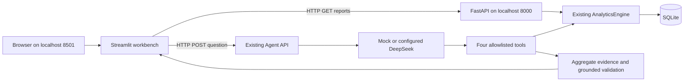

# Phase 2B — academic analysis workbench, first increment

Phase 3B — Chat-first MVP (2026-11-11, branch `feature/chat-first-agent`): [Chinese learning packet](phase3b-review/LEARNING.zh-CN.md) · [file inventory and verification record](phase3b-review/FILES.md) · [browser acceptance screenshots](phase3b-review/). A new `chat_app.py` entry renders a conversational first screen while the legacy five-step `streamlit_app.py` and its nine `AppTest` contracts stay untouched. Server-side synthetic activation now produces `source=generated` and an explicit `grounded` query mode; uploaded workbooks stay `uploaded_local_only` on the provider-free `local` path. The UI projects deterministic Chinese conclusions, charts and expandable Evidence from backend numbers only, and the `get_catalog` side-query exception was removed from `validate_intent_call()`. 29 new Mock tests; **456 tests pass**. Real FastAPI + Streamlit startup and four headless-Chrome screenshots verify the flow; no paid LLM call was made.

Phase 3A — Academic Semantic Layer formally integrated into the configured Function Calling loop (2026-11-11, branch `feature/chat-first-agent`): [Chinese learning packet](phase3a-review/LEARNING.zh-CN.md) · [file inventory](phase3a-review/FILES.md). Chinese questions are compiled locally into an ASCII `ACADEMIC_INTENT` before any external model call, `validate_intent_call()` now blocks C01→C02 drift before execution, uploaded data stays on the provider-free `local` path, and clarification/unsupported notices need no API key. 29 new Mock regression tests; **427 tests pass**. No paid LLM call, no Streamlit change; Chat-first UI remains the next increment.

Takeover and baseline repair (2026-11-11, branch `feature/chat-first-agent`): [Chinese learning packet](takeover-baseline/LEARNING.zh-CN.md) · [file inventory](takeover-baseline/FILES.md). Starting commit `d7c010a`; 10 pre-existing uncommitted files preserved in WIP checkpoint `31834ad`, with the regenerated offline receipt deliberately left out of Git. `api.py` called `AgentService.query()` with four arguments while `service.py` accepted one, causing 8 failures. The repair restores that contract without weakening any assertion and opens a provider-free local path: **398 tests pass**. Chat-first UI, semantic-layer wiring and `validate_intent_call` integration remain the next increments; no paid LLM call was made.

Synthetic validation module (2026-11-11): [configurable fictional college XLSX generation and verification](02b-synthetic-generator.md). Generate normal, edge-case or conflicting records locally, then reuse explicit review/confirmation; old fixed fixtures and analytics remain unchanged.

Current UX update (2026-11-11): [readability, workflow guidance, aggregate detail downloads and actual visual checks](02b-ux-usability.md). This update corrects the dark-theme contrast defect, removes unusable future-step actions, and keeps technical evidence in a secondary local ZIP.

Current increment (2026-11-10): [Phase 2B.1 staff workflow, learning record and actual browser evidence](02b1-workflow.md). The interface now starts at Upload, requires review/confirmation before Analysis, and reserves Writing/Export without executing them. Production startup does not seed demo data. The first-increment behavior and limitations below are historical, not the current operator guide.

Subsequent increment (2026-11-09): a separate [college XLSX adapter, explicit preview/confirmation flow and verification record](02b-college-import.md) now supports the bounded single-sheet export described there. The historical first-increment status below is retained as a record; arbitrary wide WPS/Excel formats remain unsupported.

This is a portfolio demonstration over synthetic data. It is inspired by the owner's academic reporting work and has not been deployed at a college. The supplied report screenshots informed the three views, not the dataset or numerical expectations.

## Step 1 — review and minimal change

The review covered `models.py`, `schema.sql`, `storage.py`, `analytics.py`, `schemas.py`, `api.py`, the generator/importer, the Agent package and existing tests.

| Question | Before this increment | Decision |
|---|---|---|
| Major / grade / course type? | Grade existed on classes and courses. Major and course type did not exist. | Add optional `classes.major` and `courses.course_type`, default `unspecified`. |
| Course-level multidimensional report? | Summary handled one scope; comparison handled classes for one course. | Add a course report endpoint, keeping the original endpoints. |
| Reusable analytics? | `summarize`, `ratio`, `BINS`, exact score sums, snapshot/version checking. | Group one existing snapshot and call `summarize` for each course and total. |
| Necessary backend additions? | No course-grouped rows, fail/excellent rates or course-mean classification. | Add these on the backend and return one report consumed by every view. |
| Existing policy? | Graded only, pass ≥60, missing/exempt excluded; two-decimal half-up display. | Preserve it and document the denominator on the page. |
| Compatibility risk? | Strict upload headers, stable fingerprints, databases without new columns. | Idempotent additive migration, optional import columns, unchanged legacy payloads. |

The user explicitly confirmed excellent rate as **graded records scoring ≥80 / graded records ×100**. It is not inferred from the screenshots.

No new Agent tool or framework was added. The original four tools and their argument contracts remain intact. The Agent catalog deliberately omits the new reporting fields. The legacy `/api/catalog` wire response also keeps its original fields; the new metadata is available through `/api/reports/catalog`.

## Step 2 — backend implementation

`AnalyticsEngine.course_report(ReportScope(...))` reads a single SQLite transaction into one Pandas frame. Existing aggregation produces totals and individual course statistics. Additional deterministic calculations use the existing `ratio()` and integer hundredths.

New endpoints:

| Endpoint | Purpose |
|---|---|
| `GET /api/reports/catalog` | Versioned classes, courses, terms and available major/type choices. No student rows. |
| `GET /api/reports/courses` | Term, grade, class, course, major and type filters, plus optional `expected_version`. |

The course report includes top-level scope, dataset hash, UTC generation time, policy, overall summary, course rows and backend-assigned mean bands. Every course row exposes exact counts, score sum, distribution, average, pass rate, fail rate and excellent rate. Rows represent courses with selected enrollments. A catalog course with no selected enrollments is omitted. An enrolled course with no graded records remains visible with null metrics and no mean band.

Unknown entities return 404, invalid or extra query fields return 422, mismatched versions return 409, and an inactive dataset returns 503. A valid combination with no matching enrollments returns an empty report with null rates/means.

### Data changes and compatibility

The five business tables remain normalized. The existing v1 contract receives two optional categorical columns with SQL checks and Pydantic enums.

| Field | Values |
|---|---|
| `classes.major` | `computer_science`, `business_administration`, `information_systems`, `unspecified` |
| `courses.course_type` | `general_required`, `professional_required`, `professional_elective`, `practical`, `unspecified` |

Existing databases migrate automatically at startup. Unknown legacy classifications stay unknown. Old CSV/XLSX headers remain accepted; only the declared optional columns may be added. Mixed known/unknown rows retain uniform export columns. Classification values are included in the canonical fingerprint when present. All-unknown classifications are omitted from canonical payloads, preserving the legacy dataset hash.

`generate_dataset(reporting_metadata=True)` assigns explicit synthetic categories without changing RNG draws, enrollments or scores. Its version is `08274cb073400a293be4fad8adf8a15e2f92235ba98a2b5ce694d586dc51d204`. New empty application databases use this variant. Existing databases are never relabeled or replaced at startup. The original generator default retains its original hash and regression fixture.

The startup scripts select a separate `data/workbench-demo.sqlite3`. CLI exports can opt in with `--reporting-metadata`; their manifest identifies generator revision 2.

### Unified reporting policy

| Item | Rule |
|---|---|
| Valid denominator | Graded enrollment records. This is not an average of student means. |
| Pass / fail | Score ≥60 / score <60, respectively. Both divide by graded count. |
| Excellent | Score ≥80 divided by graded count. |
| Record-score bands | `[0,60)`, `[60,70)`, `[70,80)`, `[80,90)`, `[90,100]`. |
| Display labels | `0–<60`, `60–<70`, `70–<80`, `80–<90`, `90–100`, covering decimal scores precisely. |
| Course-mean bands | Same mathematical intervals, applied to the exact rational course mean before rounding. |
| Display | Two decimals for scores/rates, explicit `%`, half up, null shown as `—`. |
| Missing/exempt | Separate counts, excluded from numerical metrics, never imputed as zero. |
| Titles | Table A, Figure B, Table C, with term/scope displayed above the views. |
| Color | Pass green `#16826C`, fail orange `#D67632`, fixed 0–100 percent axis. |
| Long names / samples | Horizontal bars, bounded label width, full tooltip with numerator and graded sample size. |
| Provenance | Full report hash, UTC timestamp, scope, separate AI Evidence and request ID. |

A mean of 79.995 displays 80.00 but is classified in `[70,80)`. Display rounding never changes classification. Independently rounded rates may have small rounding differences when summed; the integer numerators are authoritative. A course without grades never becomes a low-performing course by default.

Knowledge demonstrated: relational dimensions, backwards-compatible schema changes, parameter-bound filtering, transaction snapshots, denominator selection and exact versus displayed arithmetic.

## Step 3 — Streamlit and actual HTTP



`DashboardClient` uses HTTPX to call FastAPI. It validates typed responses, disables redirects/proxy inheritance and translates failures into readable page messages. Read requests time out after 10 seconds; query requests allow 130 seconds, covering the backend's configurable 120-second maximum Agent deadline. No database, analytics engine or model provider is imported into the frontend.

The sidebar contains term, grade, major, class, course type and course filters. Submitting `Load analysis` requests one report. The header and downloads use that response's scope, so changing controls alone cannot relabel older numbers. Session state retains reports and answers across normal UI reruns. Dataset-version changes produce a visible warning or a version conflict.

Standard startup commands and the full post-reboot procedure are in [START_HERE.zh-CN.md](../../START_HERE.zh-CN.md). The scripts are syntax checked; the underlying Uvicorn/Streamlit startup commands were executed in the HTTP smoke test. This increment did not automate clicking the PowerShell launch scripts themselves.

Knowledge demonstrated: client/server boundaries, process environment, ports, HTTP status handling, typed transport contracts and Streamlit reruns/session state.

## Step 4 — business views and AI

- Table A shows course names/types, five record-score counts, mean, pass/fail/excellent rates, graded count and missing/exempt counts, with CSV download.
- Figure B uses the exact pass/fail values in the same report. The frontend only projects the backend values into chart records.
- Table C uses the backend's course IDs already assigned to mean bands, grouped into course-type columns. It does not classify rounded averages in the browser.
- Report preview provides scope, findings, method and provenance. Formal Word/PDF export remains deferred.
- AI Copilot submits only `{question}` to `/api/agent/query`, then displays the validated answer, separate suggestions, Evidence, scope, dataset version, Trace and available token usage.

The Agent does **not** inherit sidebar filters and does not support major/type filtering yet. The page explicitly states this. Questions must identify their own supported scope. This prevents a selected major report from being presented as the source of an unfiltered Agent answer.

Mock is visibly labeled simulated. Opening the page never triggers inference. For an external provider, the user must authorize and submit the question. Keys belong only in the backend process environment. Uploaded datasets remain barred from the Agent, and no student records are sent externally. Restricted English/privacy gating, strict tool arguments, version checks, call limits and grounding are unchanged.

Knowledge demonstrated: reuse of deterministic results across views, display formatting versus computation, user-triggered inference and auditable claims.

## Verification and actual results

The original 168 tests are included in this increment's regression. The first backend milestone passed **196 tests**. Separate dashboard tests passed **23**, and real TCP/API/Streamlit tests passed **11**. The complete final suite passed **230 tests in 45.72 seconds**, with zero failures or skips. The final JUnit receipt is the authoritative result. One existing Starlette TestClient deprecation warning remains.

```powershell
& '.\.venv\Scripts\python.exe' -m pytest -q --basetemp=.test-tmp-manual
& '.\.venv\Scripts\python.exe' scripts/smoke_dashboard.py
& '.\.venv\Scripts\python.exe' -m pip check
```

All automatic model calls used Mock or scripted transports. No paid DeepSeek call was made in Phase 2B. Phase 2A's user-run live result remains a separate verification record.

| Actual HTTP sample, G1-C01 / 2026-T1 | Result |
|---|---:|
| Enrolled / graded / missing / exempt | 484 / 469 / 6 / 9 |
| Passed / failed | 318 / 151 |
| Mean | 69.73 |
| Pass / fail rates | 67.80% / 32.20% |
| Excellent count / rate | 136 / 29.00% |
| Record-score counts, low to high | 151 / 79 / 103 / 85 / 51 |
| Course mean band | `[60,70)` |

Across all 96 courses, 36 exact means fall in `[70,80)` and 60 in `[60,70)`. The other mean bands are empty. These are outcomes of this synthetic generator, not findings about the college in the screenshots.

The smoke receipt records **15 passed checks**, including real Uvicorn and headless Streamlit startup, six filter combinations, count identities, actual Vega-Lite/chart/CSV agreement, empty results, bad parameters, version conflicts, Streamlit AppTest form submissions against real TCP, Mock Agent/Evidence display, unavailable-API errors and cleanup of both child services. AppTest executes page logic; it does not establish browser pixel layout or rendering across devices.

The original `scripts/smoke_http.py` and `scripts/smoke_agent.py` were also rerun successfully, with **7/7** and **6/6** checks respectively. Their legacy synthetic fixtures are now explicitly initialized before Uvicorn starts, so the newer enriched bootstrap cannot change their expected versions. The latter made exactly two requests to its local scripted model stub. Their regenerated JSON receipts were byte-identical to the tracked originals.

Evidence files:

- `results/phase2b-core.xml` — backend milestone, 196 tests.
- `results/phase2b-pytest.xml` — complete regression, including actual HTTP tests.
- `results/phase2b-http-smoke.json` — actual HTTP checks, report sample and Mock answer.

### Problems found and fixes

1. Existing Pandas 3.1.0 failed to load its sparse native extension because of Windows application control. Reinstalling the same official wheel did not fix it. The supported official Pandas 2.3.3 wheel plus its pytz dependency loaded successfully; the new lock file records the tested environment. No security policy was disabled.
2. An initial chart test inspected a layered Altair chart's encoding at the wrong level. It was corrected to inspect the actual layer encoding and the smoke check also compares plotted Vega-Lite data to the backend values.
3. The isolated Streamlit subprocess lacked a home directory. The smoke helper now supplies a temporary home alongside the temporary DB, without inheriting credentials.
4. Final review found the frontend's original 60-second query timeout shorter than the backend's allowed 120-second deadline. It now allows 130 seconds and the client test checks that margin.
5. Sandbox restrictions caused local thread/loopback test runs to stall. Those attempts were stopped and the same checks were rerun with normal Windows permissions. Only completed runs are reported as passing.
6. The legacy HTTP smoke scripts relied on the application's implicit bootstrap hash, which changed with enriched reporting metadata. They now explicitly seed their original generated fixtures and both real HTTP checks passed again.

## Completion boundary and remaining gaps

Completed: versioned course report API, compatible metadata extension, six filters, three views, consistent CSV export, preview, HTTP-only Streamlit client, existing Agent integration, readable errors, startup instructions and executed tests.

Partial: natural-language analysis is available through the original Agent scope only. English vocabulary remains restricted; dashboard major/type filters are not Agent arguments. The preview is an on-page standardized structure.

Deferred or unverified:

- A real DeepSeek query through this new page has not been executed. The prior Phase 2A backend live check passed separately.
- No browser screenshot, browser automation, mobile/accessibility acceptance, or cross-browser visual review was performed.
- No complete 36-question Agent evaluation, Docker, Word/PDF export or production deployment in this increment.
- No individual student, party-member, student-leader, warning-list or other sensitive-group query.
- Existing imports accept normalized tables, not arbitrary wide-format WPS/Excel score sheets. Real-world adapters require a separate validated mapping step.
- `missing` currently does not distinguish absence, pending entry and other missing reasons. Retakes, grade replacement, cohort year, Chinese names/labels and curriculum rules need explicit future policies.
- Major is assigned to a class, and course type globally to a course. Real curricula may classify the same course differently by major, cohort and term. Synthetic category assignment is not curriculum validation.
- This is a local two-process demo without multiuser authorization or production-grade access controls.

Recommended next increment: add a tested report-to-Agent scope bridge for major/type analysis, then a documented wide-sheet import template and a manual browser/authorized live-page acceptance. Preserve aggregate-only privacy restrictions. Full evaluation and delivery remain Phase 3.

## Changed files and responsibilities

| Files | Responsibility |
|---|---|
| `src/copilot/models.py`, `schema.sql`, `storage.py` | Optional metadata, migration, canonical payload and consistent report/catalog reads. |
| `src/copilot/schemas.py`, `analytics.py`, `api.py` | Report contracts, deterministic course grouping/classification and endpoints. |
| `src/copilot/data/generate.py`, `data/importing.py` | Opt-in enriched synthetic data and backwards-compatible optional input columns. |
| `src/copilot/agent/tools.py` | Keep new reporting metadata outside the unchanged Agent catalog contract. |
| `streamlit_app.py`, `src/copilot/dashboard/__init__.py`, `app.py`, `client.py`, `presentation.py` | Entry point, page/forms, HTTP boundary and display-only chart/table/CSV projections. |
| `tests/test_course_reports.py`, `test_dashboard.py`, `test_dashboard_http.py` | Exact expected results, compatibility, UI and actual TCP integration. |
| `scripts/smoke_dashboard.py`, `start_backend.ps1`, `start_dashboard.ps1` | Isolated acceptance checks and daily local startup. |
| `scripts/smoke_http.py`, `smoke_agent.py` | Explicit legacy synthetic fixtures, preserving earlier HTTP acceptance checks. |
| `pyproject.toml`, `requirements.lock.txt`, `.env.example` | Dashboard extra, tested dependency versions and frontend API URL reference. |
| `README.md`, `START_HERE.zh-CN.md`, this file and the three receipts above | Project guide, novice startup workflow, implementation/verification record. |

Pre-existing Phase 2A provider/DeepSeek regression edits were preserved and subsequently committed separately from Phase 2B. The owner's pre-existing offline receipt remains uncommitted. They are not new Phase 2B work. The upstream MIT notice and author credit remain intact; no upstream runtime code was copied for this increment.

## Learning and independent review packets

From this increment onward, every development round records its baseline, file inventory, implementation/verification status, executed tests, important code and tradeoffs. See [the Phase 2B learning record](phase2b-review/LEARNING.zh-CN.md) and [file inventory](phase2b-review/FILES.md). Repository instructions in `AGENTS.md` preserve this workflow for subsequent rounds.

This retrospective packet starts at `01dbba2`, the commit that preceded Phase 2B. It includes the carried-over Phase 2A fix as a separate commit. The original work was not committed at each historical milestone; the current commits reconstruct coherent review units after successful tests. Future rounds must commit after each independently verified increment.

The documentation-only packet preparation reran the unchanged business code with `python -m pytest -q --basetemp=.test-tmp-review-packet --junitxml=docs/development/results/phase2b-review-pytest.xml`: **230 passed, one existing warning, 19.79 seconds**. No business code was modified to prepare these materials. Previous historical failures and unverified behavior remain recorded above.

Complete diffs, individual commit patches and a source review ZIP are exported to the ignored `.audit/review-export/` directory after the documentation commit. They cover the final committed checkpoint, including all related commits. Export artifacts stay outside their own Git history to avoid recursive diffs. The review ZIP contains source/configuration, learning notes and test evidence; it excludes `.env`, keys, SQLite databases, student data and private runtime logs. The pre-existing uncommitted offline-receipt delta is supplied separately and identified as owner-owned. Exact hashes and export commands are recorded in the packet README.

## Phase 3C — intent, evidence analysis and current-snapshot verification

The 2026-11-12 increment diagnoses both sports questions using actual recorded Mock provider messages, prevents ambiguous course references from widening scope, renders verified Chinese claim-based synthesis, and explicitly labels invalid/missing analysis fallback. The active generated SQLite dataset can be exported as XLSX with source/version guards; IDs remain available in technical details. Metric formulas and the legacy three report views are preserved.

Implementation increment 1: `6b68660` (semantic guards, readable IDs, generated snapshot export); complete regression **504 passed, 2 warnings, 55.04s**. The second implementation increment and final verification are recorded in [the file/verification inventory](phase3c-review/FILES.md). [Learning and the two diagnosed call chains](phase3c-review/LEARNING.zh-CN.md) · [Controlled-planning design](phase3c-review/PLANNING.zh-CN.md).

Implementation increment 2: `e610a0e`; final complete regression **584 passed, 1 existing warning, 63.48s**. Actual Edge checks cover the synthetic import/download flow, visible clarification candidates, scripted verified Chinese analysis and original Mock fallback. Both model modes are explicitly offline; generated XLSX counts/version and independent sports statistics match.

No live DeepSeek request was authorized or made in this increment. Scripted/Mock analysis is labeled as such. The owner-owned offline receipt, handoff, review ZIP and `.workbuddy/` were preserved outside these commits.
