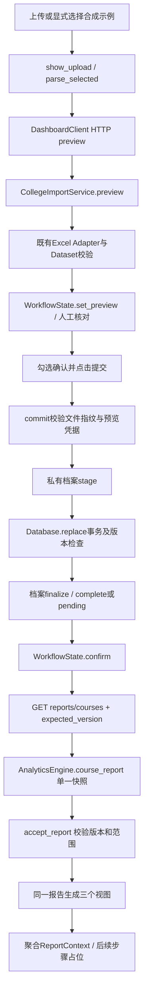
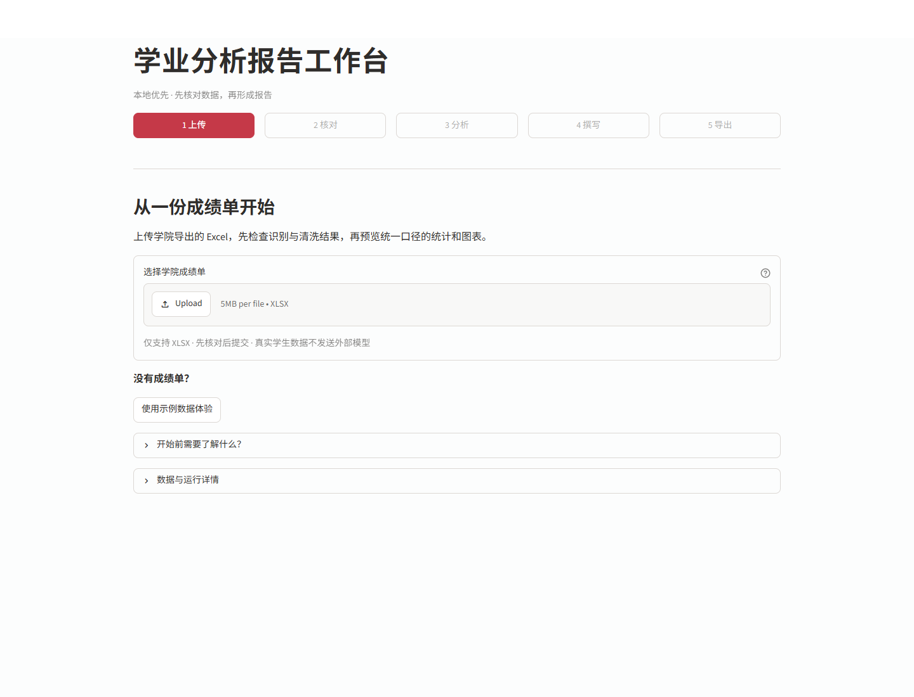
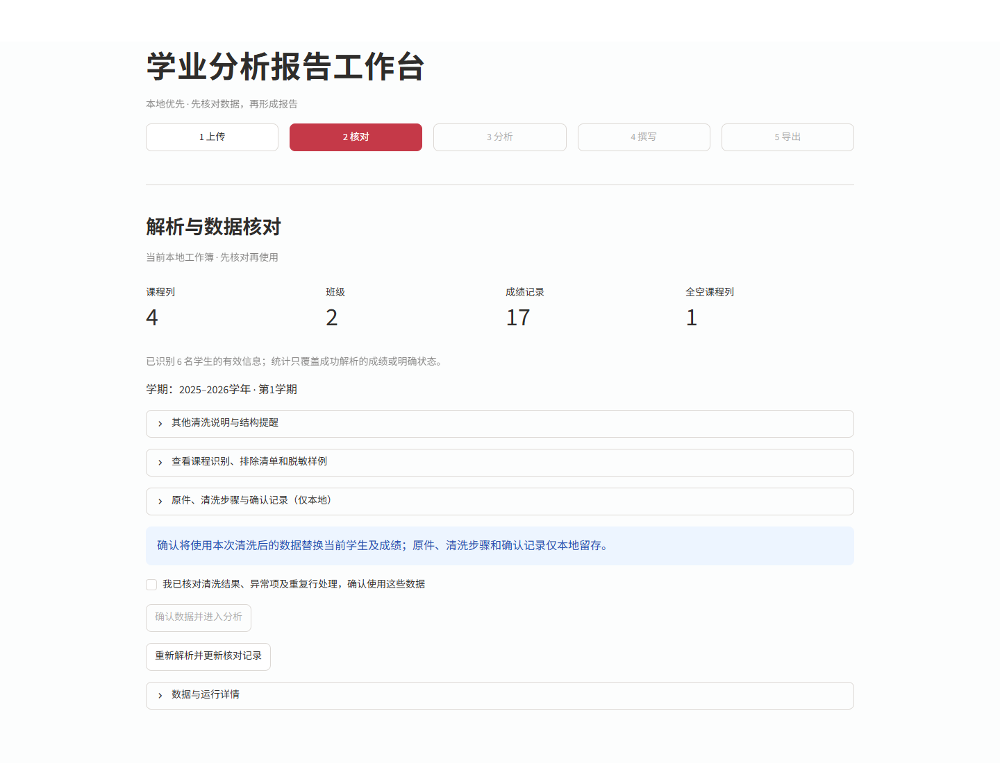
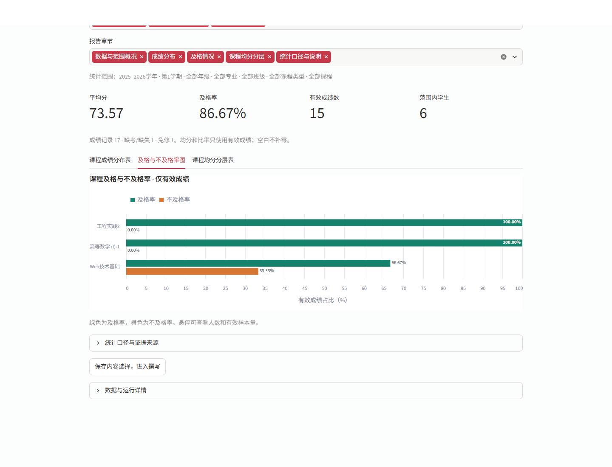

# Phase 2B.1 — 面向工作人员的报告工作流

交付日期：2026-11-10（Asia/Shanghai）。已实现**上传 → 核对 → 分析**；**撰写 → 导出**只提供导航、所选内容展示和禁用按钮，不生成报告或DOCX，不发出模型请求。

本轮基线为`c58545db2fed83fed3eb28e9d6d5eb451667feac`。开始前仅有用户原有的`docs/development/results/14-deepseek-offline-demo.json`未提交；该文件未被修改或纳入功能提交。所有本轮验证使用合成数据、隔离数据库与Mock；未读取此前真实成绩工作簿，未覆盖日常工作数据库，未推送或部署。

功能提交：`dc3969a`（状态、空库导入、私有留存）、`b74092c`（上传中心的五步界面）、`ea43496`（同名课程选择与上传大小提示）。文档与测试证据另作第四个本地提交；最终完整SHA在导出manifest中记录。

操作见[新版启动说明](../../START_HERE.zh-CN.md)，逐文件责任见[FILES.md](phase2b1-review/FILES.md)。不要沿用上一轮截图与测试数判断本轮是否完成。

## 先审查，再复用

| 检查对象 | 发现 | 本轮处理 |
|---|---|---|
| Streamlit旧首页 | 自动读取现有数据与统计，导入入口折叠，开发信息较多 | 上传成为入口，仅确认后显示筛选与统计；技术信息折叠 |
| DashboardClient | 已有类型化HTTP、超时与错误转换、预览/确认/报告接口 | 增加health读取；复用原接口，前端不读取SQLite |
| Excel Adapter | 已有安全检查、宽转长、脱敏、空值规则、重复冲突 | 不重写解析；核对阶段按问题级别展示，必须明确确认 |
| 报告API/AnalyticsEngine | 已返回同快照的CourseReport、完整范围与版本、三种视图所需字段 | 直接复用；未修改AnalyticsEngine、统计公式、SQL表结构或Agent核心 |
| Session State | 缺少完整工作流及统一失效边界 | 独立WorkflowState管理步骤、确认、范围、报告和上下文 |
| 启动与首次导入 | 生产入口默认播种，空库预览不可用 | 生产app关闭播种；空库预览与事务内空库检查；工厂保留历史测试兼容选项 |
| 原件与处理留痕 | 上轮仅会话内预览，未长期保留原件 | 确认时新增本地私有原件、清洗摘要、提交回执 |

实际结构：`streamlit_app.py`为入口；`dashboard/workbench.py`负责页面流程；`import_panel.py`负责上传和核对；`workflow.py`为无I/O状态模块；`app.py`负责三种视图和保留的旧Agent组件；`presentation.py`只投影展示；`client.py`只走HTTP。后端沿用`api.py → CollegeImportService / AnalyticsEngine → Database`。

## 工作流行为与一致性

首页只检查`/health`，不会自动请求目录或统计。即使已有数据库，新会话也不把它当作本次报告。次要入口生成6名虚构学生的小型XLSX，再走同样的预览和人工确认流程；它不是原来1,382人数据集的自动激活开关。

核对页显示课程列、班级、成绩记录、全空课程列和问题数。阻断错误、需人工核对的异常及结构提示分别展示。重复学号冲突默认阻止提交，人工选择保留首行/末行后重新预览，仍需勾选确认并点击提交。未知状态等可导入警告不会被当作成绩猜测；操作者必须核对排除项。当前是整体核对确认，不是逐问题审批系统。

确认后显示六个范围条件、课程成绩分布表、及格/不及格率图及课程均分分层表。完整版本、统计定义、证据来源放进详情区。中文显示、短课程标签和图例布局是展示变更，数字仍取自同一CourseReport。

同名同入学年的课程选项追加类别、学分、学时、学期和性质；仍相同则使用基于目录排序的稳定序号。API始终接收原course_id，不把同名课程合并。上传控件显示5 MB限制，与原有后端5 MiB字节限制一致，避免框架默认200 MB提示误导用户。

| 事件 | 状态处理 | 数据库行为 |
|---|---|---|
| 初次打开、新浏览器会话、整页刷新 | 回到未确认上传页，不显示旧报告 | 保留已有数据及档案 |
| 普通Streamlit重跑、返回上传/核对 | 当前确认保留，可返回分析 | 不重复提交 |
| 重新选择文件或来源 | 旧报告、范围、上下文和草稿失效 | 新确认前不替换 |
| 重复行策略或实质清洗结果变化 | 增加选择修订号，要求再确认 | 仅预览，不写库 |
| 仅预览凭据续期，清洗语义未变 | 不把令牌变化误判成新数据 | 不写库 |
| 六个范围条件变化 | 回调先清空旧报告/上下文/草稿，再重跑；需点击更新 | 只读 |
| 图表或章节选择变化 | 清空旧上下文/草稿；用当前统计重建 | 只读 |
| 后端版本或来源变化 | 撤销确认与旧统计，要求重新核对 | 不覆盖对方数据 |
| 暂时断线 | 暂停旧报告显示，保留确认，恢复后核实版本 | 不写库 |

版本变化在下一次页面交互/重跑时检测，未实现后台推送；静置页面不会实时监听别的进程。硬刷新不自动恢复报告是当前明确限制，后续可增加基于确认回执的恢复流程。

## 关键调用链与学习重点



### 1. UI按钮禁用之外，还要有状态不变量

```python
# workflow.py：收到响应时再次检查，而不是只相信按钮状态
if report.dataset_version != self.confirmed.dataset_version or report.scope != self.scope:
    raise WorkflowError("统计响应的范围或数据版本已失效，请重新生成。")
```

`accept_report()`还核查已观察的数据来源、顶层完整ReportScope、汇总和各课程证据版本/基本范围。`has_current_context`依赖当前确认和当前报告。按钮是体验层，状态检查是正确性边界，两者都需要。专业、课程类型属于顶层ReportScope，不能只比较旧基础Scope中的学期/班级。

筛选器`on_change=state.invalidate_analysis`在页面导航执行前运行，防止“改了条件，同时点撰写”携带旧上下文。选图表只撤销上下文，不重新算统计。这体现依赖关系：数据 → 范围 → 统计 → 内容选择 → 草稿。

### 2. 首次导入也有并发冲突

```python
# college_service.py：原件准备完成后进入既有事务
info = self.database.replace(
    parsed.dataset, expected_version=payload["version"],
    expected_empty=payload["version"] is None,
    preserve_courses=True, source="uploaded_local_only")
```

空库没有旧版本号，不能把`expected_version=None`简单理解为“无需校验”。`expected_empty`让事务检查数据库是否仍为空；若其他确认先写入，旧预览返回冲突，不能覆盖新数据。这是比较后更新的应用，而不是增加一套导入数据库。

### 3. 文件系统与SQLite不是同一个事务

确认导入先`ImportArchive.stage()`写原件与清洗摘要，成功后才写数据库，最后`finalize()`写确认回执并更名。准备失败不提交；数据库失败清理本次确切暂存目录；数据库已成功、整理失败则返回`pending`并保留原件，不能向用户谎称已经回滚。

私有路径为`<数据库目录>/.import-history/<随机档案ID>/`，其中`original.xlsx`保留原始字节；`cleaning.json`记录哈希、计数、问题分类/坐标、空值假设与重复行策略；`confirmation.json`记录提交时间、来源和版本。文件名不参与路径拼接，清洗回执不含姓名/原学号/预览行。预览不创建永久档案，重复解析历史留在会话，永久档案保存最终确认使用的清洗结果。

这不是跨文件系统与数据库的原子提交协议，也没有自动修复进程突然终止留下的pending档案。本轮验证了受控异常分支，未验证断电恢复。档案未加密、未提供身份签名或细粒度访问控制，依赖本地系统权限；Git忽略不等于脱敏。它必须留在本机，不能包含在分享包中。

### 4. ReportContext是数据契约，不是AI执行器

`ReportContext`承载确认版本/来源、完整范围、统一聚合报告、所选视图、章节、指标定义和证据（接口、计算函数、生成时间、版本/范围）。确认摘要含原件哈希和档案ID，**不含工作簿、原文件名、学生行、预览令牌**。`external_llm_allowed: Literal[False]`不能被调用方改为True；报告生成和DOCX实现标志也固定False。

它可供后续模板使用，但不构成对外发送授权。真实上传数据仍为`uploaded_local_only`，原Agent保护保留。聚合数据未来能否外发，需要另做授权和最小样本等规则审查，本轮未实现。

## 实际执行的验证

测试回执均在`results/phase2b1/`。测试时间戳保留实际执行时间；本页交付日期不是篡改后的测试日期。以下检查有重叠，不能把数量相加当成独立测试数。

| 已完成检查 | 实际结果 | 证据 |
|---|---:|---|
| 纯状态模块 | 25 passed | 后续完整JUnit包含全部用例 |
| 空库、归档及相关后端回归 | 62 passed，1条既有警告，17.57秒 | archive.xml |
| 页面工作流与旧组件 | 41 passed，1条既有警告，36.80秒 | 后续完整JUnit包含全部用例 |
| 完整自动化套件 | 344 passed，0失败/跳过，1条既有TestClient警告，终端107.24秒 | full.xml（JUnit时间107.217秒） |
| 中文展示及UI/HTTP复核 | 52 passed，1条既有警告，72.84秒 | views.xml |
| 最后图表颜色修正后的展示回归 | 23 passed，2.09秒；1条缓存目录权限警告 | final-display.xml |
| 同名课程选项修正 | 38 passed（15项UI+23项展示），1条既有警告，10.69秒 | final-ui.xml |
| 真实TCP与Streamlit AppTest冒烟 | 15/15；自建服务停止 | ../phase2b1-workflow-smoke.json |
| 真实Edge浏览器 | 10/10；10张截图；自建服务停止；截图期间源码未变 | browser.json |

完整套件是在最终图表样式细调之前执行；后续按修改范围复核展示与真实浏览器，没有把旧全量回执冒充最终源码全量重跑。原291项测试仍保留，本轮完整344项增加25项状态、7项空库、7项归档、14项UI验收；旧UI测试适配新工作流，旧Agent的授权/Evidence显示独立测试，没有让首页重新显示Agent。

最后补充1项同名异学时课程UI用例，因此最终源码共345个用例，**不宣称执行过一次345项完整回归**。该新增用例实际进入上述38项检查，验证选择48学时课程后API使用正确ID，返回2条有效成绩和85.00均分。之后仅为上传控件补充大小参数，再由最终10项浏览器检查覆盖。

各项实际检查使用的命令如下（仓库根目录，`python`表示`.venv/Scripts/python.exe`；临时目录与回执路径可另选）：

```powershell
python -m pytest -q --basetemp=.test-tmp-phase2b1 --junitxml=.audit/phase2b1-workflow/full.xml
python -m pytest tests/test_dashboard.py tests/test_college_dashboard.py tests/test_workflow_ui.py tests/test_dashboard_http.py -q --junitxml=.audit/phase2b1-workflow/views.xml
python -m pytest tests/test_dashboard.py -q --basetemp=.test-tmp-phase2b1-final --junitxml=.audit/phase2b1-workflow/final-display.xml
python scripts/smoke_dashboard.py
python -m pytest tests/test_workflow_ui.py tests/test_dashboard.py -q -p no:cacheprovider --junitxml=phase2b1-final-ui.xml
python -m pytest --collect-only -q -p no:cacheprovider
# 浏览器驱动随审查包附带，使用Edge及独立临时数据库
python phase2b1_browser_capture.py --edge
```

合成浏览器样例：空库五表计数均0；确认后6学生、2班、3有效课程、17成绩记录（15有效、1缺考/缺失、1免修），另1全空课程列排除。统一总均分73.57、及格率86.67%；切换到24软工1班后为3学生、7有效成绩。浏览器检查了未确认不激活、冲突重传不覆盖、返回不重交、刷新保留数据库、范围变更撤销旧图，以及后续占位不执行。

问题与修复记录：空库预览原先依赖已存在元数据，现已补齐；筛选/导航回调顺序可能复用旧上下文，现先撤销；图表100%标签越界或颜色被序列编码覆盖，现放进柱内并显式指定白色；图例与课程行过挤，现增加高度并移至顶部。浏览器驱动曾因控件定位和本地受限环境连接失败而中断，已改用真实指标断言并在允许的本地环境重跑。一次JUnit写回执权限失败不计为通过，之后取得项目写权限完成；最终缓存警告不影响23项断言和回执生成。

### 实际运行截图

以下均为本地Streamlit真实Edge截图，1440×1100，使用合成数据。不是设计稿。最终截图对应界面实现检查点`ea43496`；浏览器回执保存5个关键源文件SHA-256，截图期间源码未变。

上传首页：



核对及明确确认：



同一报告的及格/不及格图：



另外7张截图涵盖分析总览、成绩分布、课程均分分层、范围失效、撰写/导出占位、重复冲突。

## 交付与后续边界

已实现并有自动化证据：前三步、空库首导、明确确认、本地留存、版本/范围失效、同源三视图、聚合上下文、后续占位。浏览器证明本地Edge合成路径可运行，不代表所有真实学院表格或其他平台已验收。

未实现或未验证：最终LLM撰写、DOCX、跨会话自动恢复、后台实时版本推送、逐问题审批、私有档案自动恢复/清理、多人授权、移动端/跨浏览器/无障碍验收、生产部署。本轮不扩展重修、学分规则或新增统计。下一步应先确定报告模板、章节依赖与证据标注，以及本地报告恢复和档案生命周期，再独立审查聚合AI授权。

本轮小步提交按真实完成时间创建，没有倒造历史里程碑。累计diff从基线覆盖到最终文档检查点，逐提交patch和base/current源码都在独立ZIP；导出产物在Git之外生成，避免递归包含自己。最终完整SHA、提交列表、源文件哈希和工作区状态在ZIP的manifest中。原有用户离线回执仅以单独working-tree.diff标识，不属于实现提交。

可分享：`phase2b1-review.zip`、本页、操作说明及合成截图/测试回执。不可分享：真实XLSX、`.import-history`、SQLite、`.env`、私有运行日志。审查包显式包含根`streamlit_app.py`，避免只有模块而无法核实实际入口。
