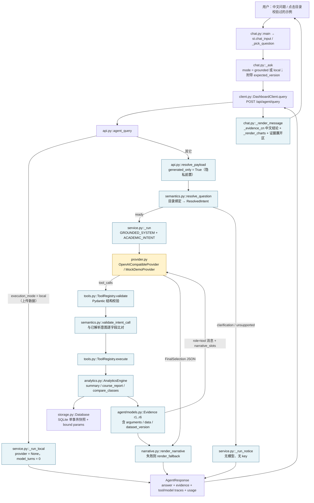

# Academic Analytics Copilot — Current System Handoff

> 用途：供另一位 AI 技术导师**独立**重新梳理系统架构、核心技术、已实现功能与下一阶段任务。
> 事实基线：当前工作区源码（分支 `feature/chat-first-agent`，HEAD `f8526e5`），审计日期 2026-11-12。
> 本文件是**现状审查 + 验证核对 + 技术交接**，不是 Phase 3A/3B 审查包的副本；历史细节只在必要处链接引用。
> 本轮未修改任何业务代码、未重构、未删除文件、未提交 Git、未发起任何付费模型调用。

---

## 1. Executive Summary（当前状态概览）

一句话结论：**这是一个已完成 Chat-first MVP、具备确定性统计内核与完整信任边界的本地单体应用；LLM 在其中的作用被刻意压缩为「受控复述工具计划 + 组织受控证据句子」，不是自主推理型 Agent。**

| 维度 | 当前事实 |
|---|---|
| 交付形态 | 本机双进程：`uvicorn copilot.api:app`（8000）+ `streamlit run chat_app.py`（8501），仅 loopback，无认证、无部署 |
| 默认界面 | `chat_app.py` → `src/copilot/dashboard/chat.py`（Chat-first）；旧五步工作台 `streamlit_app.py` 原样保留 |
| 数据来源 | 服务端生成的**合成数据**（`source=generated`）或上传 XLSX（`source=uploaded_local_only`），二者互斥且不可混用 |
| 执行路径 | 合成 → `execution_mode="grounded"`（可触达 DeepSeek）；上传 → `execution_mode="local"`（**不构造 provider，零外发**） |
| 自动化回归 | 本轮独占全量 **461 passed，0 failed/skipped，1 warning**（既存 Starlette TestClient 弃用提示） |
| 真实模型验证 | **Chat-first 的 grounded 中文链路从未用真实 DeepSeek 跑通**；仅 Mock / ScriptedProvider / `httpx.MockTransport` 覆盖。Phase 2A 曾有一次用户授权的真实调用，但属于**旧的 `configured` 英文路径**（见 §6、§8） |
| 中文能力 | 中文输入由 `semantics.py::resolve_question()` 的正则 + 目录绑定解析（规则式，不是 LLM 理解）；中文结论由 `chat.py::_evidence_cn()` 从 Evidence 数值模板生成（不是模型措辞） |
| 最大风险 | ① 真实模型链路的验证缺口；② 对外部展示时「AI 做了什么」容易被夸大或误解；③ 中文紧贴 `C001` 时解析失败（本轮实测复现） |
| 生命周期定位 | MVP 完成 + 自动化测试通过；系统测试与验收**部分完成**；发布准备**未开始**（详见 §10） |

三个最容易被误读的点，先在这里钉住：

1. **不是「LLM 自主选工具」**：工具名与全部参数在请求进入模型之前就由 Python 语义层决定（`ResolvedIntent`），模型收到的 `user` 消息是 `ACADEMIC_INTENT {...}` 这样的 ASCII JSON 计划，`GROUNDED_SYSTEM` 明确要求「call exactly that tool with exactly those arguments」。
2. **不是「模型写数字」**：所有数值来自 `AnalyticsEngine.summarize()`，经 `Evidence` 传递；`narrative.py::render_narrative()` 用正则强制句子只能引用证据 token，数字由服务端填槽；中文结论同理。
3. **上传数据从不触达模型**：`api.py::agent_query()` 对 `local` 直接构造 `AgentService(store, None)`，`_run_local()` 的 `model_turns=0`、`provider="local"`。

---

## 2. Current Git Snapshot

实际执行结果（2026-11-12，工作目录 `D:\Document\ChatGPT\SAP-ApplicationEngineer`）：

```
分支          feature/chat-first-agent
HEAD          f8526e5fd16e65b62ba22dfb5d404a114cf7b60a
```

最近五次提交：

| Commit | 说明 |
|---|---|
| `f8526e5` | `fix: locate upload issues in the original workbook and persist the confirmed upload` — 预览改为原表行号/列字母坐标、删除会话范围控件、上传数据集自动沿用、用户气泡右对齐、新增 `HANDOFF.zh-CN.md` |
| `b52bac1` | `fix: trim pasted DeepSeek keys and add a zero-token credential check` — `LLMSettings.from_env()` 对 key 做 `.strip()`，新增 `scripts/check_deepseek_key.ps1` |
| `ad6dde2` | `test: make college preview/commit fixture byte-stable` — 修复 XLSX 内嵌时间戳导致的测试 flakiness |
| `4503782` | `fix: make 502 failures self-explaining in backend logs and the operator guide` — `query_failed` 事件加 `status` 字段 |
| `94c7189` | `fix: make backend key prompting and port conflicts visible` — `-ForcePrompt`、key 来源日志、端口占用预检 |

`git status --short` 实测：

```
 M docs/development/results/14-deepseek-offline-demo.json
?? .workbuddy/
?? docs/development/phase3b-review.zip
```

三项都是**故意不提交**的内容：owner-owned 离线回执、本机工作日志、审查包副本。`main` 分支未改动。本轮新建本文件后，工作区会额外多出 `?? docs/development/CURRENT_SYSTEM_HANDOFF.md`；未执行 `git add` / `git commit`。

基础文件核对：

| 文件 | 核对结果 |
|---|---|
| `AGENTS.md` | 存在，16 行。规定每轮开发要记录起始 commit、区分「实现 / 实际验证 / 待办」、**不得把 Mock 成功表述为真实 LLM 验证**、不得未授权发起付费调用、不得提交用户自有文件。本报告的写法遵循这些约束 |
| `README.md` | 存在且本轮已同步：Chat-first 为默认界面、坐标化预览、上传数据自动沿用、跨对话交接入口 |
| `pyproject.toml` | `name=academic-analytics-copilot`, `version=0.2.0`, `requires-python >=3.13,<3.14`；依赖 FastAPI / uvicorn / Pydantic v2 / pandas / openpyxl / defusedxml / python-multipart / httpx；可选 `test=pytest`、`dashboard=streamlit + altair`；`[tool.pytest.ini_options] testpaths=["tests"], pythonpath=["src"]` |
| `docs/development/PROJECT_STATE.md` | **不存在**（`find docs -iname "*PROJECT_STATE*"` 无结果） |
| 跨对话交接 | 根目录 `HANDOFF.zh-CN.md`（已提交），提供新对话开头可粘贴的提示词、硬约束、未完成项。本文件是**技术深度交接**，两者互补而非重复 |
| 实际前端入口 | `chat_app.py`（7 行）→ `from copilot.dashboard.chat import main; main()`；`scripts/start_dashboard.ps1:18` 确实启动 `chat_app.py`。旧入口 `streamlit_app.py` → `copilot.dashboard.app.main` |
| 后端入口 | `src/copilot/api.py:294` `app = create_app(bootstrap_demo=False)` — 生产启动**不自动激活任何数据** |

文档索引（供导师按需展开，本报告不复制其内容）：`START_HERE.zh-CN.md`（操作）、`docs/development/phase3b-review/FILES.md`（Phase 3B 交付清单、8 张浏览器截图、§8 本轮修订）、`docs/development/02b-workbench.md`（各 Phase 索引）、`docs/development/02a-deepseek.md`（Phase 2A 真实调用记录）、`docs/development/phase3b-review/LEARNING.zh-CN.md`（中文学习包）。

⚠️ 发现一处文档债：`docs/development/02b-workbench.md` 的 Phase 3B 条目仍写「456 tests pass」，实际为 461（详见 §9 P2）。

---

## 3. Implemented Features

严格按「已实现并验证 / 已实现但未完整验证 / 部分实现 / 尚未实现」四档划分。「已验证」指有自动化测试或真实浏览器验收记录；「未完整验证」指代码路径存在但只有 Mock 覆盖。

| 能力 | 档位 | 依据 |
|---|---|---|
| 数据来源二选一、显式「预览 → 勾选 → 确认」 | **已实现并验证** | `chat.py::_synthetic_panel` / `_upload_panel` / `_data_source`；`tests/test_chat_app.py::test_synthetic_activation_requires_preview_and_checkbox`、`test_upload_review_confirm_then_local_only_queries` |
| 合成数据服务端生成与激活 | **已实现并验证** | `data/synthetic_activation.py::SyntheticActivationService.preview/commit`（只收 options，服务端生成并解析 XLSX，HMAC 签名 15 分钟 token）；`tests/test_synthetic_activation.py`、`test_phase3b_backend.py::test_synthetic_activation_is_server_side_and_grants_generated_provenance` |
| Excel 上传、解析、异常处理 | **已实现并验证** | `data/college.py::parse_college_workbook`（256 列 / 5000 学生 / 50000 成绩上限、重复学号/课程列、合并单元格、未知状态）；`tests/test_college_adapter.py`（24 个用例） |
| 预览中的完整问题清单 + 原表坐标 | **已实现并验证** | `college.py` 的 `review_cells`（原表行号 + `get_column_letter()`）、`sample_total` / `issue_cell_total`、问题单元格优先、上限 200 并提示省略；`chat.py::_preview_overview`；浏览器截图 `review-issues-with-coordinates.png` |
| 已确认上传数据集跨页面沿用 | **已实现并验证** | `chat.py::_observe_dataset()`；`test_confirmed_upload_is_restored_on_a_fresh_page`；截图 `review-auto-restored.png`。合成数据**不**沿用（避免意外付费） |
| 自然语言问题输入（中文 / 目录校验过的示例问题） | **已实现并验证** | `chat.py::st.chat_input` + `_examples()`（逐条调用 `/api/agent/resolve` 只保留 `status=ready`）；`test_example_questions_are_catalog_verified_and_readable` |
| 意图理解与工具选择 | **已实现并验证（确定性规则）** | `agent/semantics.py::resolve_question()`：正则识别比较 / 目录 / 指标 / 概览，绑定课程名、课程 ID、班级 ID、中文班级序号、专业别名、入学年级、学期，产出 `ResolvedIntent(tool, arguments, canonical_question)`；`tests/test_agent_semantic_integration.py` 约 20 个用例 |
| 班级 / 课程 / 成绩统计 | **已实现并验证** | `analytics.py::summarize()` / `AnalyticsEngine.summary()` / `course_report()` / `compare_classes()`：均分、学分加权均分、及格率、缺考/免修、不及格记录数、失败学生数、五段分布、未四舍五入精确均分排名；`tests/test_analytics.py` |
| 图表与自然语言结果 | **已实现并验证** | `chat.py::_evidence_cn()`（中文结论，全部取自 `Evidence.data`）、`_render_charts()`（成绩分布 / 各班均分柱状图）、`_render_message()`；`test_chinese_course_and_class_questions_show_statistics_and_charts` |
| 证据与溯源 | **已实现并验证** | `agent/models.py::Evidence / ToolTrace / ModelTrace / AgentResponse`；`service.py::event()` 结构化 JSON 日志；`tools.py::digest()` SHA-256；前端「计算证据与技术详情」+「执行记录」两个折叠区 |
| 异常、歧义、不支持请求 | **已实现并验证** | `semantics.py::_UNSUPPORTED` / `_INJECTION` 正则、未知实体 → `needs_clarification` + `choices`；`AgentError` → `client.py::ERROR_MESSAGES` → `chat.py::NEXT_STEPS`；`test_ambiguous_and_unsupported_questions_get_friendly_guidance` |
| grounded 路径的完整模型循环 | **已实现但未完整验证** | 代码在 `service.py::_run()`，覆盖 Mock / ScriptedProvider / MockTransport；**真实 DeepSeek 未在当前 Chat-first 中文链路上跑通** |
| 会话范围继承（`SessionScope`） | **部分实现** | 后端 `QueryRequest.scope` + `resolve_question(session_scope=...)` 仍支持学期等条件继承（`_term()` 的 `inherited`），并有 `test_confirmed_session_scope_is_reused_and_returned`；但 Chat-first 前端在 `f8526e5` 删除了范围面板，`_ask()` 不再传 scope。能力在、入口无 |
| 历史对话 / 真正多轮上下文 | **部分实现** | `chat.py::_state()["messages"]` 只是**显示列表**；每题独立解析，模型 `messages` 每轮仅 system + 当前 `ACADEMIC_INTENT`（+ 本轮工具消息），**不含历史轮次**。`_state()["scope"]` 目前只写不读（残留状态） |
| 执行阶段可视化 / SSE 流式 | **尚未实现** | `AgentResponse.stages` 字段与 `agent/models.py::ExecutionStage` 已定义但恒为空；`/api/agent/status` 明确 `streaming: False`；页面只有 spinner |
| 真实 DeepSeek 中文端到端、Agent Evaluation 矩阵 | **尚未实现（验证缺口）** | 见 §6、§8 |
| 移动端 / 无障碍 / 跨浏览器验收 | **尚未实现（验证缺口）** | `FILES.md` §6 明确列为未覆盖 |
| ZIP 明细下载（Chat-first 页面） | **尚未实现** | 只在旧工作台 `dashboard/audit_export.py` 中可用；`START_HERE.zh-CN.md` 附录有说明 |

补充说明（用户视角的重要边界）：

- 页面只支持**四类聚合分析**（数据集概览 / 单课程成绩 / 同课程班级比较 / 课程与班级目录），明确拒绝个人名单、排名、预测、因果解释（`chat.py::SUPPORTED` 与 `semantics.py::_UNSUPPORTED`）。
- 空白成绩单元格**不生成记录、不按零分处理**；缺考 / 免修单列；均分与及格率的分母恒为「有分数的选课记录」。
- 每条回答首行标注实际分析方式，四种之一：`_answer_mode_label()` 区分真实 DeepSeek / 离线 Mock / 本地规则 / 本地语义解析（澄清与拒绝）。这个标注是诚实的，未把 Mock 冒充为真实模型。

---

## 4. Architecture & Module Map

### 4.1 技术与分层

| 层 | 技术 | 主要文件 |
|---|---|---|
| 前端 | Streamlit 1.67+、Pandas 画图、少量 CSS | `chat_app.py`、`dashboard/chat.py`、`dashboard/presentation.py`；旧工作台 `streamlit_app.py` + `dashboard/{app,workflow,workbench,import_panel,synthetic_panel}.py` |
| HTTP 边界 | httpx（`trust_env=False`、`follow_redirects=False`）、Pydantic 响应校验 | `dashboard/client.py::DashboardClient` |
| API | FastAPI + 四个 `UploadBodyLimit` 中间件 + 统一异常处理器 | `api.py::create_app()` / `app` |
| 契约 | Pydantic v2（`extra="forbid"`、`frozen=True`、`SecretStr`、`Annotated` 约束） | `schemas.py`、`models.py`、`agent/models.py`、`data/college.py::CollegePreview` |
| 语义层 | 纯 Python 正则 + NFKC 归一化 + 目录绑定，无模型、无 I/O | `agent/semantics.py` |
| Agent 编排 | asyncio、`asyncio.timeout`、有界循环（4 轮 / 6 工具调用） | `agent/service.py::AgentService` |
| LLM 适配 | DeepSeek Chat Completions / OpenAI 兼容 / 显式模拟 Mock | `agent/provider.py` |
| 工具层 | 四个只读工具 + 白名单 + 二次 Pydantic 校验 | `agent/tools.py::ToolRegistry` |
| 叙述层 | token 模板 + 正则强校验 + 确定性兜底 | `agent/narrative.py` |
| 统计 | Pandas（确定性聚合）+ Decimal / Fraction（精确比较） | `analytics.py` |
| 存储 | SQLite（固定 SQL、bound parameters、单事务快照） | `storage.py::Database`、`storage/schema.sql` |
| 导入 | openpyxl / defusedxml、HMAC 预览令牌、私有归档 | `data/college.py`、`college_service.py`、`synthetic_activation.py`、`import_archive.py`、`importing.py` |
| 测试 | pytest + `streamlit.testing.v1.AppTest` + `httpx.MockTransport` + FastAPI `TestClient` | `tests/`（28 个测试模块，461 用例） |
| 日志 | `copilot.agent` logger 输出结构化 JSON 事件 | `service.py::configure_logging()` / `event()` |

### 4.2 数据流与控制流



阅读要点：

- **黄色节点是唯一可能触达外部模型的环节**，且它收到的 `user` 内容不是中文原句，而是服务端生成的 ASCII `ACADEMIC_INTENT` JSON。
- **上传数据的 `local` 分支完全绕过黄色节点**：`api.py:176-181` 直接构造 `AgentService(store, None)`。
- 每个统计数字都在 `analytics.py` 产生，经 `Evidence` 单向流到前端；模型与前端都不产生新数字。
- 数据激活是独立的两条链路：`/api/datasets/synthetic/{preview,commit}` 与 `/api/datasets/college/{preview,commit}`，都要求 `confirmed=True` 与 HMAC 预览令牌。

### 4.3 关键类 / 函数职责速查

| 符号 | 位置 | 职责 |
|---|---|---|
| `create_app()` / `app` | `api.py:86` / `:294` | 组装 FastAPI、中间件、异常处理器、全部路由；生产 `bootstrap_demo=False` |
| `resolve_payload()` | `api.py:157` | 读取 overview + reporting_catalog，校验版本一致性，调用语义层；`generated_only` 在此前置拒绝上传数据 |
| `agent_query()` | `api.py:174` | 三条执行路径的分流点（local / grounded / 遗留 configured） |
| `resolve_question()` | `agent/semantics.py:116` | 把中文/英文问题编译为 `ResolvedIntent`；产出 `canonical_question` |
| `validate_intent_call()` | `agent/semantics.py:278` | 拒绝模型提出的任何工具或参数偏离（含多余的 `get_catalog` 旁路） |
| `AgentService.query()` / `_run()` / `_run_local()` / `_run_notice()` | `agent/service.py:121` / `:210` / `:159` / `:191` | 有界模型循环、本地确定性路径、澄清/拒绝路径 |
| `LLMSettings.from_env()` / `OpenAICompatibleProvider.complete()` / `MockDemoProvider` | `agent/provider.py:43` / `:112` / `:169` | 配置校验（含 `SecretStr`、官方 origin 校验）、DeepSeek 请求体、离线脚本回放 |
| `ToolRegistry.definitions/validate/execute` | `agent/tools.py:27` / `:39` / `:49` | 四工具白名单、严格 Pydantic 参数校验、分发到统计引擎、生成 Evidence |
| `render_narrative()` / `available_tokens()` / `slots_for()` | `agent/narrative.py:109` / `:105` / `:68` | 把 Evidence 数值转成受控 token，强校验模型句子，填槽生成最终英文回答 |
| `AnalyticsEngine` / `summarize()` | `analytics.py:49` / `:22` | Pandas 确定性统计；`Decimal` ROUND_HALF_UP；`Fraction` 精确均分比较 |
| `Database.snapshot()` / `check_access()` / `replace()` | `storage.py:155` / `:138` / `:85` | 单事务快照与范围校验、`expected_version` CAS、来源与 `external_llm_allowed` 写入 |
| `parse_college_workbook()` / `CollegePreview` | `data/college.py` | XLSX 解析、清洗、问题定位、`review_cells` 坐标化预览 |
| `CollegeImportService` / `SyntheticActivationService` | `data/college_service.py:19` / `data/synthetic_activation.py:39` | 预览/确认边界、HMAC token、来源不可伪造 |
| `ImportArchive` | `data/import_archive.py:25` | 只落盘 `original.xlsx` / `cleaning.json` / `confirmation.json`，不含样本或单元格原文 |
| `_observe_dataset()` / `_ask()` / `_evidence_cn()` / `_render_message()` | `dashboard/chat.py:107` / `:526` / `:177` / `:238` | 数据集版本守卫与自动沿用、提问提交、中文结论渲染、证据展示 |

---

## 5. End-to-End Execution Trace

### 5.1 先澄清用户给出的示例问题

用户示例是「比较 2024 级软件工程 1 班与 2 班某门实际存在课程的成绩」。本轮通过真实本地 HTTP 请求 `/api/agent/resolve` 实测（Mock 后端、合成数据 `cohort=2024, academic_year_start=2025, semester=1`）：

| 实测输入 | 返回 |
|---|---|
| 原句（课程名写作「某门实际存在课程」） | `needs_clarification`：「班级比较需要一门明确课程和至少两个明确班级，请补充或从目录选择。」 |
| `比较 2024 级软件工程 1 班与 2 班的高等数学 (I)-1 成绩` | `ready`，`tool=compare_classes`，`arguments={term:"2025-T1", course_id:"I18af9e72424622315e2cddcc", class_ids:["C001","C002"]}` |
| `比较 C001 和 C002 的高等数学 (I)-1 成绩` | `ready`，同上 |
| `比较C001和C002的高等数学 (I)-1 成绩`（中文紧贴、无空格） | `needs_clarification` — **见 §9 P1-1 的实测缺陷** |

所以：**该示例必须写出具体课程名才能执行**；`resolve_question()` 的 `compare` 分支在 `semantics.py:260-267` 要求 `values["course_id"]` 与至少两个 `class_ids`，否则返回澄清。另注意 `2024 级` 是入学年级（cohort），而 `term` 是学年起始年 `2025-T1`，两者不是同一个概念（合成数据生成器 `synthetic_college.py:133` 的 `class_label = f"{options.cohort}{short}{class_number}班"`）。

### 5.2 完整调用链（以可执行的完整问题为例）

1. **前端事件**：`chat.py::main()` 渲染 `st.chat_input()`；示例按钮经 `_pick_question()` 写入 `st.session_state.pending_question`，下一轮由 `_ask()` 消费。
2. **决定执行模式**：`chat.py::_ask()` → `_mode(state)`：合成数据 → `"grounded"`；上传数据 → `"local"`；同时带上 `expected_version = state["dataset"].dataset_version`。
3. **HTTP 请求**：`client.py::_query_payload()` 生成 `{question, execution_mode, expected_version}`，`DashboardClient.query()` POST `/api/agent/query`（`trust_env=False`，130 秒超时）。
4. **API 路由**：`api.py::agent_query()`。对 `grounded` 先调 `resolve_payload(payload, generated_only=True)` — `Database.overview(generated_only=True)` 在**读取任何模型配置之前**用 `check_access()` 拒绝上传数据（`agent_privacy_block` 403）；随后 `Database.reporting_catalog()` 与 `resolve_question()` 产出意图，并二次 `overview()` 防止解析期间来源被替换。
5. **模型上下文构建**：`api.py:189-200` 计算 `grounded` 与 `needs_model`；ready 时构造 provider 并调用 `AgentService.query(..., intent=intent, execution_mode="grounded")`。
6. **语义层（确定性 Python）**：`semantics.py::resolve_question()` → `ResolvedIntent`，其中 `canonical_question = "ACADEMIC_INTENT " + json.dumps({"tool": ..., "arguments": ...})`（ASCII、只含目录 ID，不含中文原句、姓名、学号）。
7. **模型第一轮**：`service.py::_run()` 构造 `messages = [{"role":"system","content":GROUNDED_SYSTEM},{"role":"user","content":canonical}]`，调用 `provider.complete(messages, registry.definitions())`。`GROUNDED_SYSTEM` 要求「call exactly that tool with exactly those arguments」并禁止 `get_catalog` 旁路。
8. **参数验证（确定性）**：模型返回的 tool_call 先经 `ToolRegistry.validate()`（工具白名单 + `SummaryArgs`/`ComparisonArgs` 等 Pydantic 严格校验 + 4096 字节上限），再经 `validate_intent_call()` 与 `intent.arguments` 逐字段比对；不一致即 `intent_mismatch` 422，**在统计执行之前**阻断。
9. **统计引擎（确定性）**：`ToolRegistry.execute()` → `AnalyticsEngine.compare_classes()` → `Database.snapshot()`（SQLite 单事务、bound params、`check_scope()` 校验实体存在）→ `AnalyticsEngine.summarize()`（Pandas）→ `Evidence(evidence_id="r1", tool, dataset_version, arguments, data)`；`digest()` 生成 SHA-256 结果摘要写入 `ToolTrace`。
10. **模型第二轮**：Evidence 以 `role: tool` 消息回传，附 `narrative_slots`（`available_tokens()` 生成的 `{{r1.C001.mean}}` 等 token）；模型返回 `FinalSelection` JSON（status + evidence_ids + narrative 句子 + 可选 guidance 码）。
11. **答案验证与生成**：`selected_evidence()` 拒绝未验证/重复/不存在的 evidence_id；`render_narrative()` 用 `SENTENCE` 正则强制句子只能由 scope token + 1~3 个 clause token 组成，数字由 `slots_for()` 从 `Evidence.data` 填槽；任何不合规 → `deterministic_fallback` + `fallback_reason`（`service.py:289-298`）。
12. **响应**：`AgentResponse`（`answer`, `evidence`, `tool_calls`, `model_trace`, `usage`, `answer_mode`, `resolved_scope`, `dataset_version`）。
13. **前端展示**：`chat.py::_render_message()` → `_evidence_cn()` 用 **Evidence 数值**生成中文结论、`_render_charts()` 画柱状图、折叠区展示每条证据的参数与结果、`request_id` / `model_turns` / `answer_mode` / 后端英文原文；若 `result.dataset_version` 与当前数据集不同则警告不可比较。

### 5.3 分工表（这一节最关键的诚实性结论）

| 步骤 | 由谁完成 | 证据 |
|---|---|---|
| 中文分词/实体识别、课程与班级绑定、学期推断 | **确定性 Python 正则 + 目录查询** | `semantics.py::resolve_question()`；无模型调用 |
| 决定工具名 | **确定性 Python**（`ResolvedIntent.tool`） | `semantics.py::_result()` |
| 决定全部工具参数 | **确定性 Python**（`ResolvedIntent.arguments`） | `semantics.py:266` 的 `compare_classes` 分支 |
| 生成发给模型的用户消息 | **确定性 Python**（`ACADEMIC_INTENT` JSON） | `semantics.py:51` |
| 发起 function call | 模型形式上生成 tool_call，但内容必须逐字复述计划；偏离即被拦截 | `service.py:240-267`、`validate_intent_call()` |
| 参数结构与意图一致性校验 | **确定性 Python** | `ToolRegistry.validate()` + `validate_intent_call()` |
| 统计计算 | **确定性 Pandas / Decimal / Fraction** | `analytics.py::summarize()` |
| 数值写入回答 | **确定性 Python 填槽** | `narrative.py::render_narrative()`、`service.py::render_fallback()`、`chat.py::_evidence_cn()` |
| 句子选择、顺序、连接词、guidance 码 | **模型真正参与**（仅从允许集合内挑选） | `FinalSelection.narrative` / `guidance` |
| 中文结论与图表 | **确定性前端模板** | `chat.py::_evidence_cn()` / `_render_charts()` |

**模型如何收到上下文**：只有 `system`（`GROUNDED_SYSTEM` + `narrative.py::PROMPT`）、`user`（ASCII `ACADEMIC_INTENT`）、以及本轮 `assistant` / `tool` 消息。没有对话历史、没有中文原句、没有学生级数据、没有数据库内容（`test_chinese_question_sends_only_verified_intent_to_provider` 断言外发 JSON 中不含「分析」「平均分」「Synthetic Student」「student_id」）。

**如何防止参数偏离**：双重校验 — 结构合法性由 Pydantic 保证，语义正确性由 `validate_intent_call()` 保证（`service.py:254-258` 注释明确「Structural validity is not intent correctness」）。`tests/test_agent_semantic_integration.py` 有 `test_model_course_drift_is_blocked_before_any_statistic`、`test_model_wrong_tool_is_blocked`、`test_model_may_not_change_class_or_term`；Phase 3B 还移除了 `get_catalog` 旁路例外（`test_grounded_loop_blocks_a_model_initiated_catalog_side_query`）。

**如何保证数字正确**：模型输出中不允许出现字面数字 — `SENTENCE` 正则只接受 token 与固定连接词；数字由 `slots_for()` 从 `Evidence.data` 生成。`test_grounded_path_still_rejects_fabricated_narrative_numbers`、`test_unverified_model_prose_falls_back_with_trace`、`test_empty_scope_cannot_publish_mean_slot` 覆盖伪造数字、无效叙述与空范围。中文结论同理，只读取 `item.data`。

**执行失败如何处理**：`AgentService.query()` 统一捕获 `TimeoutError` / `AgentError` / `DataError` / 其它异常，附 `request_id`、`tool_calls`、`model_trace`，记录 `event("query_failed", ..., error_code, status, tool_count)` 后抛出；`api.py` 的 `AgentError` 处理器转成 HTTP（默认 502）；`client.py::ERROR_MESSAGES` 映射为可执行中文提示；`chat.py::NEXT_STEPS` 给出下一步。工具失败记为 `ToolTrace(status="error", error_code=...)` 且**不返回半成品答案**。注意 502 不是反向代理故障，是 `AgentError` 默认状态码（`agent/models.py:172`），DeepSeek 401 也被显式映射为 502。

**遗留的 `configured` 路径**：`api.py:189-200` 中，纯 ASCII 且 `execution_mode` 为默认 `configured` 时 `intent=None`，走 `canonical_question()`（`agent/privacy.py`）英文词汇门控 + `SYSTEM`，此时模型**可以**自主选择工具与参数（仍受白名单与 Pydantic 约束）。Chat-first 前端的 `_ask()` 永远传 `grounded` 或 `local`，因此这条路径只服务旧工作台或直接 API 调用，且被历史 `test_agent_service.py` / `test_agent_api.py` 契约锁定。Phase 2A 的真实 DeepSeek 调用就发生在这条路径上。

---

## 6. Actual LLM Responsibilities

按用户提出的九个子问题逐条客观回答。

**1) 当前 DeepSeek 的输入内容与消息结构**
`service.py::_run():225` 固定为 `[{"role":"system","content": system}, {"role":"user","content": canonical}]`，后续追加 `assistant`（含 tool_calls）与 `role:"tool"`（含 `tool_call_id`、Evidence JSON 与 `narrative_slots`）。grounded 路径的 `system` 是 `GROUNDED_SYSTEM + PROMPT`，`user` 是 `ACADEMIC_INTENT {"tool":...,"arguments":...}`。请求体由 `provider.py::OpenAICompatibleProvider.complete():117-121` 构造：`model=deepseek-flash`、`tools`（4 个，移除 `strict`）、`tool_choice=auto`、`stream=False`、`thinking={"type":"disabled"}`、`max_tokens=2048`、`response_format={"type":"json_object"}`。`test_deepseek_chat_completions_full_api_round_trip` 逐项断言了这个请求体。

**2) 是否真的参与工具选择和参数生成**
**在当前 Chat-first grounded 路径上：否。** 工具与参数已由 `resolve_question()` 决定，模型被要求原样复述；任何差异在 `validate_intent_call()` 处被拒绝。模型只是**在协议层面**产生 tool_call 消息，没有选择空间。仅遗留 `configured` 英文路径才允许模型自主选工具（`MockDemoProvider` 与 `ScriptedProvider` 也模拟了这一点）。

**3) 本地语义层是否已预先决定工具和参数**
**是，完全决定。** `ResolvedIntent.tool` 与 `ResolvedIntent.arguments` 在 `api.py::resolve_payload()` 阶段就确定，`dataset_version` 也绑定在意图上；`service.py::_run():215-221` 只把 `intent.canonical_question` 与 `GROUNDED_SYSTEM` 交给模型。

**4) 是否参与最终自然语言解释**
**有限参与。** 模型返回 `FinalSelection.narrative`（由允许的 evidence token 与连接词组成的英文句子）与 `guidance` 码；`render_narrative()` 逐句校验后把 token 替换为 Evidence 中的实际数值文本。模型决定「说哪几句、什么顺序、用哪个连接词」，**不决定任何事实内容**。若模型的 narrative 缺失或违规，服务端用 `render_fallback()` 生成确定性英文答案（`answer_mode="deterministic_fallback"`）。中文结论始终由前端模板生成，与模型无关。

**5) 最终回答是模型生成、规则模板生成，还是二者组合**
**组合，但事实部分 100% 由规则模板生成。** 英文 `answer` = 模型选句骨架 + 服务端填槽（或完全兜底）；中文「统计结论」= 前端 `_evidence_cn()` 模板；图表 = 前端数值绑定。因此面试时应表述为「evidence-grounded constrained generation」，而不是「LLM 生成分析报告」。

**6) 是否存在不调用 LLM 也能完成同一任务的场景**
**存在，而且是多数已验证场景**：
- 上传数据 → `local` 路径，`provider=None`、`model_turns=0`、`answer_mode="verified_localized"`（本轮 HTTP 探针实测）；
- 澄清 / 不支持 → `_run_notice()`，`provider="semantic"`，无 key、无请求；
- `/api/agent/resolve` 端点 → 纯本地语义解析；
- grounded 但模型 narrative 无效 → `deterministic_fallback`；
- 离线 Mock 模式 → `MockDemoProvider` 脚本回放（不是 LLM）。
换言之，**四个工具的全部统计能力都不依赖 LLM**；LLM 只影响英文措辞的组织方式。

**7) Mock 模式与真实 DeepSeek 的行为区别**

| | Mock（`MockDemoProvider`） | 真实 DeepSeek（`OpenAICompatibleProvider`） |
|---|---|---|
| 本质 | `agent/provider.py:169` 的 Python 分支回放，**不是 LLM** | POST `https://api.deepseek.com/chat/completions` |
| 第一轮 | 解析 `ACADEMIC_INTENT` 原样返回 `call_1` tool_call | 模型按 system 指令生成 tool_call（可能被 `validate_intent_call()` 拒绝） |
| 第二轮 | 汇总 tool 结果中的 `evidence_id` 返回 `FinalSelection`；仅 `get_score_summary` 才附一句简单 narrative | 模型按 `PROMPT` 选择并排序 token 句子 |
| 典型 `answer_mode` | 常为 `deterministic_fallback`（本轮实测 `数据概览` 问题即如此） | `grounded_narrative`（若 narrative 通过校验） |
| 费用 / 网络 | 零 | 按 token 计费，可能因 401 / 402 / 429 / 超时失败 |
| `simulated` 字段 | `True` | `False` |

`tests/conftest.py::explicit_offline_provider` 通过 autouse fixture 强制 `COPILOT_LLM_PROVIDER=mock` 并删除 `COPILOT_LLM_API_KEY`，**保证全套 461 个测试不会发起任何付费调用**。

**8) 当前 LLM 在系统中的实际价值与局限**
价值：① 在严格约束下把结构化意图与证据转换为可读英文句子，展示 function-calling 协议、工具结果回填与证据选择；② 提供一层「模型可能偏离意图」的真实风险，从而让 `validate_intent_call()`、evidence 校验、fallback 等可信性机制有明确的工程意义；③ 为后续 Agent Evaluation 提供可评测的对象。
局限：不做中文理解、不做实体识别、不做工具规划、不写数字、不解释因果、不记忆历史；在上传数据路径上完全缺席；输出被正则限制到近乎模板；一旦真实模型不遵守 `PROMPT`，系统只会退回确定性答案而不是「更聪明的回答」。称它为「Domain-Specific Agent」是**架构定位**，不是当前能力描述。

**9) 有哪些真实测试证据支持上述结论**
- `tests/test_agent_semantic_integration.py::test_chinese_question_sends_only_verified_intent_to_provider`：断言外发 `user` 消息以 `ACADEMIC_INTENT ` 开头、计划与 `SUMMARY_ARGS` 完全相等，且外发内容不含中文与身份字段。
- 同文件 `test_model_course_drift_is_blocked_before_any_statistic` / `test_model_wrong_tool_is_blocked` / `test_model_may_not_change_class_or_term`：模型偏离即 422，且统计未执行。
- `tests/test_deepseek_narrative.py::test_unverified_model_prose_falls_back_with_trace`、`test_grounded_path_still_rejects_fabricated_narrative_numbers`：模型写数字/无效句子 → fallback。
- `tests/test_deepseek_narrative.py::test_deepseek_chat_completions_full_api_round_trip`：完整验证 DeepSeek profile 的**请求体与响应解析契约**，但使用 `httpx.MockTransport`，**不是真实网络调用**。
- `tests/test_agent_local_mode.py`（3 个用例）：上传数据不构造 provider、不冒充 DeepSeek。
- `tests/test_phase3b_backend.py::test_uploaded_dataset_only_answers_locally_and_blocks_grounded`。
- 本轮真实本地 HTTP 探针（§8.3）：`grounded` 在 Mock 下 `model_turns=2` 且 `answer_mode=deterministic_fallback`；`local` 下 `provider=local`、`model_turns=0`、`verified_localized`。
- 历史真实调用：`docs/development/02a-deepseek.md:34-35` 记录 Phase 2A 用户授权的一次 live 成功（HTTP 200、`simulated:false`、`grounded_narrative`、`deepseek-flash` **自主选择** `get_score_summary`）。**该记录属于旧的 configured 英文路径，不能用来证明当前 Chat-first grounded 中文链路已被真实模型验证。**

---

## 7. Validation, Privacy & Reliability

| 机制 | 调用链位置 | 解决的问题 | 已通过的测试 / 证据 |
|---|---|---|---|
| Pydantic 严格契约 | `QueryRequest`（`agent/models.py:67`）、`ComparisonArgs` / `SummaryArgs` / `CatalogArgs`、`Scope(extra="forbid", frozen=True)`、`CollegePreview` | 拒绝多余字段、越界参数、非法 ID；`SecretStr` 防 key 进 repr | `test_deepseek_env_defaults_and_key_repr`、`test_agent_tools.py`、`test_api.py` |
| 业务实体匹配与歧义处理 | `semantics.py::resolve_question()`：最长课程名优先、专业别名、中文班级序号、学年/学期、课程与班级入学年级一致性 | 不猜测、不静默替换；歧义返回 `needs_clarification` 与 `choices` | `test_resolve_endpoint_maps_chinese_entities_to_catalog_ids`、`test_chinese_aliases_and_metrics_select_the_expected_tool`、`test_explicit_course_in_question_is_never_silently_replaced` |
| `validate_intent_call()` | `service.py:254-258`，**统计执行前** | 结构合法但语义错误的调用（C01→C02、换工具、换班级/学期、多余 `get_catalog`） | `tests/test_agent_semantic_integration.py`（4 个）、`test_phase3b_backend.py`（3 个） |
| 工具白名单与二次校验 | `tools.py::TOOLS` / `validate()` / `execute()` | 模型不能执行任意 SQL/Python/文件/URL；程序化调用方也要再校验 | `tests/test_agent_tools.py` |
| 数据集版本校验 | `Database.check_access()`、`expected_version` CAS、`api.py::resolve_payload()` 二次 overview、`_run()` 每轮 + 返回前 overview、`chat.py::_observe_dataset()` | 防止解析/执行期间数据被替换导致错版结果混用 | `test_stale_expected_version_is_rejected_before_the_model`、`test_stale_resolved_intent_version_is_rejected`、`test_final_turn_data_change_invalidates_answer`、`test_dataset_version_switch_clears_chat_history_and_scope` |
| Evidence 统计证据 | `Evidence(evidence_id, tool, dataset_version, arguments, data)`；`ToolTrace.result_digest` = SHA-256 | 每个数字可追到具体工具、参数、版本 | `test_grounded_chinese_comparison_executes_real_tool_with_matching_evidence`；本轮探针断言 `ToolTrace.arguments == Evidence.arguments` 且版本一致 |
| Trace / 日志 | `service.py::event()` 输出 `query_started` / `model_turn` / `tool_call` / `query_completed` / `query_failed`（含 `status`）；`ModelTrace` 记录 provider_response_id 与 usage | 排查 502/401、还原执行过程 | `START_HERE.zh-CN.md` 的 502 排查表基于该日志；`test_deepseek_narrative.py` 断言 key 不出现在 caplog |
| 数值与最终回答验证 | `selected_evidence()`、`SENTENCE` 正则、`slots_for()`、`render_fallback()`、`_evidence_cn()` | 模型不能引用未验证证据、不能写数字、空范围不能发布均分 | `test_unverified_model_prose_falls_back_with_trace`、`test_empty_scope_cannot_publish_mean_slot`、`test_grounded_path_still_rejects_fabricated_narrative_numbers` |
| 合成 / 上传数据隔离 | `Database.replace(source=...)` → `external_llm_allowed = (source=="generated")`；`check_access(generated_only=True)` → `agent_privacy_block` 403；前端 `_mode()` 由 `state["dataset"].source` 决定 | 上传数据永远不外发，且不能通过伪造来源标记绕过 | `test_uploaded_data_never_reaches_the_configured_provider`、`test_uploaded_data_local_answer_is_not_impersonated_as_deepseek`、`test_synthetic_activation_is_server_side_and_grants_generated_provenance`；本轮探针确认 `external_llm_allowed=true` 仅出现在合成数据 |
| 显式确认与私有归档 | HMAC 预览 token（15 分钟）+ `confirmed is True` + 文件 SHA-256 绑定；`ImportArchive.stage/finalize` 只写 3 个文件，且不写 `sample`/单元格原文/姓名 | 预览不落盘原件、确认才激活、归档失败不产生误导性回滚信息 | `tests/test_college_api.py`、`test_import_archive.py`、`test_preview_rows_keep_canonical_scores_and_never_leak_identity` |
| 隐私输入门控 | `semantics.py::_UNSUPPORTED` / `_INJECTION`；`privacy.py::canonical_question()`（仅遗留 configured 路径） | 拒绝名单/学号/个人成绩/预测/因果/注入式指令；英文路径限制词汇 | `test_agent_semantic_integration.py` 的 unsupported 参数化用例、`tests/test_agent_service.py` |
| API Key 与敏感信息保护 | `LLMSettings.api_key: SecretStr`、`from_env()` `.strip()`、`_safe_error_path()` 只回白名单字段、`check_deepseek_key.ps1` 不打印 key/长度/余额、测试 fixture 删除环境变量 | 隐藏式粘贴带空白导致 401（已修）、供应商错误体不外泄、key 不入日志 | `test_deepseek_http_errors_are_sanitized`、`test_schema_diagnostic_omits_untrusted_field_names_and_values`、本轮探针日志无 key |
| 上传大小与结构限制 | `api.py::UploadBodyLimit`（4 处）、`read_upload()` 5 MiB、`college.py` 的行/列/单元格上限 | 防止超大 multipart、ZIP 膨胀、内存耗尽 | `test_actual_coordinate_limits_are_checked_before_openpyxl_allocates_rows`、`tests/test_college_api.py` |

**尚未覆盖的失败模式（客观缺口，不是已发现的 Bug）：**

1. 真实 DeepSeek 在 grounded 中文链路上的行为：模型是否会遵守 `ACADEMIC_INTENT`、`response_format=json_object` 下 tool_calls 与 finish_reason 是否一致、真实 `usage` 字段形态、401/402/429/超时的端到端恢复 — 全部只有 MockTransport 覆盖。
2. 模型返回内容触发的新型失效（递归 JSON、超长 narrative、非预期 `refusal`、`content_filter`）在真实供应商下的表现。
3. Agent Evaluation 维度：工具选择正确率、参数漂移率、歧义处理、跨版本一致性、隐私泄漏探测、成本/延迟分位数 — 无矩阵、无基线。
4. `reporting_catalog()` 不接受 `expected_version`，目录读取与 `overview()` 之间的版本一致性由 `resolve_payload()` 手动比对，存在极小的 TOCTOU 窗口（后续 `overview()` 二次校验与 `_run()` 每轮校验缓解，但没有并发注入测试）。
5. 预览 token 的 HMAC 密钥是进程内随机（`secrets.token_bytes(32)`），重启即全部失效 — 这是设计（`preview_expired`），但没有多实例/重启场景测试。
6. 应用是 loopback 单用户、无认证、无速率限制；未做并发写、恶意 multipart、路径遍历之外的安全测试（文件名不当路径用、`.import-history` 私有目录权限已测）。
7. `check_deepseek_key.ps1` 与 `start_backend.ps1` 只有本地 stub / 语法级验证，无自动化回归（提交 `b52bac1` 说明中已注明）。

---

## 8. Testing & Runtime Evidence

### 8.1 本轮实测：分层结果

运行环境：Windows x86-64、Python 3.13.6（`.venv`）、`tests/conftest.py` autouse fixture 强制 `COPILOT_LLM_PROVIDER=mock` 且删除 `COPILOT_LLM_API_KEY`。**所有命令均为独占运行，未并行跑两个 pytest 进程**（曾有 XLSX 时间戳导致的 flakiness，见提交 `ad6dde2`）。

完整命令（每条都实际执行）：

```
.venv/Scripts/python.exe -m pytest -q --tb=short --basetemp=.test-tmp-audit-full
.venv/Scripts/python.exe -m pytest -q --tb=short --basetemp=.test-tmp-audit-g1 tests/test_analytics.py tests/test_data.py tests/test_imports.py tests/test_synthetic_college.py tests/test_workflow_state.py
.venv/Scripts/python.exe -m pytest -q --tb=short --basetemp=.test-tmp-audit-g2 tests/test_api.py tests/test_agent_api.py tests/test_college_api.py tests/test_course_reports.py tests/test_dashboard_http.py
.venv/Scripts/python.exe -m pytest -q --tb=short --basetemp=.test-tmp-audit-g3 tests/test_agent_service.py tests/test_agent_tools.py tests/test_agent_local_mode.py tests/test_agent_semantic_integration.py tests/test_llm_provider.py tests/test_deepseek_narrative.py tests/test_phase3b_backend.py
.venv/Scripts/python.exe -m pytest -q --tb=short --basetemp=.test-tmp-audit-g4 tests/test_chat_app.py tests/test_dashboard.py tests/test_college_dashboard.py tests/test_synthetic_panel.py tests/test_workflow_ui.py tests/test_workflow_empty.py
.venv/Scripts/python.exe -m pytest -q --tb=short --basetemp=.test-tmp-audit-g5 tests/test_college_adapter.py tests/test_college_compatibility.py tests/test_import_archive.py tests/test_audit_export.py tests/test_synthetic_activation.py
.venv/Scripts/python.exe -m pytest --collect-only -q
```

| 验证类型 | 当前结果 | 证据 |
|---|---|---|
| Unit Tests（统计、数据契约、导入、生成器、工作流状态） | **94 passed / 11.29s** | G1 分组；`tests/test_analytics.py` 等 5 文件 |
| Integration Tests（跨模块：API↔DB↔Engine↔Agent） | 包含在 G2/G3/G5；全量 **461 passed / 147.93s** | 全量命令；`tests/test_agent_semantic_integration.py`、`test_phase3b_backend.py`、`test_synthetic_activation.py` 均为真实 FastAPI `TestClient` + 临时 SQLite |
| API Tests（路由、契约、错误码、上传边界） | **85 passed, 1 warning / 28.08s** | G2 分组；`test_api.py`、`test_agent_api.py`、`test_college_api.py`、`test_course_reports.py`、`test_dashboard_http.py` |
| Agent Mock Tests（模型循环、语义、narrative、provider） | **129 passed, 1 warning / 16.42s** | G3 分组；Mock / ScriptedProvider / `httpx.MockTransport`，零外部请求 |
| Streamlit / 浏览器测试 | AppTest **75 passed, 1 warning / 59.76s**；真实浏览器见下行 | G4 分组（`streamlit.testing.v1.AppTest`）；另有 headless Chrome CDP 验收 8 张截图，见 `FILES.md` §5/§8 |
| 真实 DeepSeek API 测试 | **本轮未执行（且未授权）；当前 Chat-first grounded 链路无真实调用记录** | 历史仅 Phase 2A 旧 configured 路径一次用户授权调用（`02a-deepseek.md:34-35`）；`test_deepseek_chat_completions_full_api_round_trip` 是 MockTransport |
| 端到端功能测试 | **已执行（本地 HTTP，Mock）**：本轮只读探针 + 历史浏览器验收 | §8.3；`FILES.md` §5/§8 的 8010/8511 + CDP 记录 |
| 隐私与异常测试 | **78 passed, 1 warning / 9.75s** | G5 分组；另有 `test_agent_local_mode.py`（3）、`test_phase3b_backend.py` 隐私用例、`test_import_archive.py` |

合计 `94 + 85 + 129 + 75 + 78 = 461`，与 `--collect-only` 的 `461 tests collected in 3.81s` 及全量 461 passed 完全一致（五个分组互斥且覆盖全部 28 个测试模块）。**失败数 0、跳过数 0**；唯一警告是既存 `StarletteDeprecationWarning: Using httpx with starlette.testclient is deprecated`。

### 8.2 「是否已经执行」逐项核对

| 项目 | 结论 | 说明 |
|---|---|---|
| 真实 DeepSeek API 调用 | **否（当前链路）** | Phase 2A 有一次历史 live 成功，属旧 configured 英文路径；本轮与 Chat-first 全部验收都用 Mock。未发起任何付费调用 |
| 中文自然语言分析 | **是，但需限定含义** | 中文输入由规则式语义层解析、中文输出由前端模板生成，均已在 AppTest / HTTP / 浏览器验证；**LLM 从未收到中文原句** |
| 真实前后端 HTTP 联调 | **是** | 历史：8010 FastAPI + 8511 Streamlit 真实进程 + `/health`、`/api/agent/status`、`/api/dataset` 实测（`FILES.md` §5）。本轮：独立端口 uvicorn + httpx 端到端探针（§8.3） |
| 完整浏览器交互 | **是（历史验收，本轮未重跑）** | headless Chrome 157 + CDP 真实鼠标事件：预览 → 勾选 → 确认 → reload 自动沿用 → 点击示例问题；8 张截图保存在 `docs/development/phase3b-review/` |
| Excel 上传后的分析 | **是（历史验收 + 自动化测试）** | `test_upload_review_confirm_then_local_only_queries`（AppTest）；CDP 上传含坏单元格的 `review-with-issues.xlsx` → 坐标化问题清单 → 确认 → 自动沿用 → 提问得到「统计结论」。后端为 Mock，上传数据本来走 local 路径 |
| 连续多轮对话 | **否** | 未实现真正的多轮上下文；每题独立解析，历史仅作显示。见 §3、§9 P1-4 |
| Agent Evaluation | **否** | 无评测矩阵、无基线、无自动化评分 |

### 8.3 本轮只读 HTTP 探针（可作为可复现证据）

脚本 `.test-tmp-probe/audit_http.py`（临时、被 `.gitignore` 覆盖、不进 Git）启动独立 uvicorn（随机 loopback 端口、`ACADEMIC_DB_PATH` 指向临时库、`COPILOT_LLM_PROVIDER=mock`），完成请求后自行 `terminate()`；**未写任何 tracked 文件、未使用 key、未访问外网**。关键输出摘要：

```
health                 HTTP 200  {"status":"ok","dataset_active":false,"version":"0.2.0"}
agent_status           HTTP 200  provider=mock, model=scripted-demo-v1, simulated=true,
                                 tools=[4], max_model_turns=4, max_tool_calls=6, streaming=false
dataset_before         HTTP 503  {"error":{"code":"no_dataset"}}
synthetic_preview      HTTP 200  students=6, classes=2, enrollments=24,
                                 sample_total=24, issue_cell_total=0, can_import=true
synthetic_commit       HTTP 200  source=generated, external_llm_allowed=true,
                                 dataset_version=db63382a…（64 位十六进制）
query_grounded_mock    HTTP 200  provider=mock, simulated=true, model_turns=2,
                                 answer_mode=deterministic_fallback,
                                 evidence r1 = get_dataset_overview，
                                 ToolTrace.arguments == Evidence.arguments，版本一致
query_local            HTTP 200  provider=local, model=deterministic-tools-v1,
                                 simulated=false, model_turns=0,
                                 answer_mode=verified_localized
resolve_without_course HTTP 200  needs_clarification（用户原句省略课程名）
resolve_full           HTTP 200  ready / compare_classes /
                                 {term:2025-T1, course_id:I18af…, class_ids:[C001,C002]}
resolve_spaced_ids     HTTP 200  ready（"比较 C001 和 C002 的…"）
resolve_compact_ids    HTTP 200  needs_clarification（"比较C001和C002的…"）
probe_service_stopped  True
```

两点特别值得记给导师：
- `grounded` + Mock 的 `answer_mode` 是 **`deterministic_fallback`**（Mock 不为概览问题生成 narrative），这恰好实证「数字由 `render_fallback()` 从 Evidence 生成，模型没写数字」。
- `local` 路径 `model_turns=0` 且 `simulated=false`、`provider="local"` — 前端 `_answer_mode_label()` 先判 `provider == "local"` 再判 `simulated`，所以不会被误标为 Mock。

历史回执文件位于 `docs/development/results/`（JUnit XML / HTTP smoke JSON / manifest）；本轮结论以上述实测为准，未把历史数字当作当前结果。

---

## 9. Known Issues & Technical Debt

按对「功能正确性 / AI 真实性 / 交付可信度」的影响分级。每条都给实际证据，未虚构问题。

### P0 — 阻断「可对外宣称 AI 能力」的验证缺口

**P0-1　Chat-first grounded 中文链路从未用真实 DeepSeek 端到端验证**
- 证据：`docs/development/02a-deepseek.md:34-35` 的 live 成功属于 Phase 2A 旧 `configured` 英文路径（模型自主选 `get_score_summary`）；当前 Chat-first 永远传 `grounded`/`local`，`GROUNDED_SYSTEM` + `ACADEMIC_INTENT` 只有 Mock / ScriptedProvider / `httpx.MockTransport` 覆盖。`tests/conftest.py` 强制 Mock。`FILES.md` §6、§8 与 `HANDOFF.zh-CN.md` 都把「授权后的真实 DeepSeek 端到端」列为未完成项。用户近期遇到的 `llm_authentication_error` / 502 也停留在凭证与配置层，未走到成功回答。
- 影响：无法诚实回答「真实模型在你的新界面上跑通过吗」；面试演示若含合成数据 + 中文提问，实际跑的是 Mock 或会失败。
- 建议：在用户明确授权后做**一次**真实调用（固定一个目录校验过的问题），保存脱敏回执（`request_id`、provider、model_turns、tool_calls、answer_mode、fallback_reason、Evidence 数值与独立计算的一致性、usage），并明确标注这是哪条路径。不要为了「看起来更 AI」而改架构。

### P1 — 影响正确性或表述真实性，演示前建议修

**P1-1　中文紧贴 `C001` 时班级 ID 解析失败（本轮实测复现）**
- 证据：`semantics.py:207` 用 `\bC(\d{1,3})\b`；中文字符属于 `\w`，所以 `比较C001和C002的…` 中 `C001` 两侧没有 ASCII 词边界。本轮 HTTP 探针：`比较 C001 和 C002 的…` → `ready`，`比较C001和C002的…` → `needs_clarification`。`START_HERE.zh-CN.md:81` 只能建议「班级编号与课程名之间留空格」作为规避；`FILES.md` §6 也把该项列为待修。
- 影响：用户按自然书写习惯提问会得到无谓的澄清，且示例问题的正确性依赖空格，面试现场容易翻车。
- 建议：改用 ASCII 感知的 lookaround（例如 `(?<![A-Za-z0-9])C(\d{1,3})(?![A-Za-z0-9])`）或先做中文/数字边界归一化，补紧凑写法、中英文混排、课程别名 `C\d+` 的参数化回归。注意 `semantics.py:185` 的 `explicit_course_aliases` 也用了同类 `\b`，需一并检查。

**P1-2　页面宣称「AI 负责选择工具」与源码不符**
- 证据：`chat.py:572` 的 `_intro()` 写「AI 只负责选择工具与组织语言」；但 grounded 路径下工具与参数由 `resolve_question()` 预先决定，`GROUNDED_SYSTEM` 要求模型原样复述，`validate_intent_call()` 会拒绝任何自主选择。`START_HERE.zh-CN.md:100` 的「模型不能自行写入数字」是准确的，但「选择工具」不是。
- 影响：这是**技术真实性**问题，导师或面试官一读源码就会发现陈述夸大；也是本项目最容易被误读的地方。
- 建议：改为「系统先由本地语义层确定工具与参数，再由受控模型复述执行并组织措辞，任何偏离都会被拦截」；同步 `README.md` 与演示话术。

**P1-3　班级比较图表在「无有效成绩」时会画出 0 分，且文字标注与实际数据不一致**
- 证据：`chat.py:220-225` `_render_charts()` 中 `float(row["average_score"]) if ... is not None else 0.0` — 某班 `average_score=None`（无有分数记录）会被画成 0 分柱；同段 caption 写「使用未四舍五入的精确均分」，但用的是已 ROUND_HALF_UP 到 2 位的显示值 `average_score`（精确比较实际发生在 `analytics.py:86` 的 `Fraction(sum, graded_count)`）。
- 影响：与「空白不按零分处理」「无有效成绩时均分不可用」的设计原则冲突，图表会给出文字结论里不存在的 0 分；面试演示若出现空班容易被追问。
- 建议：无成绩班级跳过或显式标注「无有效成绩」；caption 改为「按后台精确均分排名，柱高为显示均分」或直接显示排名信息；补对应 AppTest 断言。

**P1-4　「聊天」形态与真正多轮上下文的差距未在界面上说清，且有残留状态**
- 证据：`chat.py::_ask():526` 每题只发当前问题；`_state()["scope"]` 在 `:83 / :535 / :542` 被写入或清空，但**没有任何读取点**（`f8526e5` 删除范围面板后遗留）。后端 `SessionScope` 仍能继承学期（`semantics.py::_term()` 的 `inherited`），并有 `test_confirmed_session_scope_is_reused_and_returned`，但 UI 不再传 `scope`。
- 影响：用户可能以为系统记得上一题；导师评估「Agent 能力」时容易把「显示历史」误当成「上下文记忆」。
- 建议：要么清理 `state["scope"]` 并在文档中明确「无多轮上下文」，要么在后续迭代中作为**明确范围增项**实现（需配套版本与隐私校验）；不要在面试中把显示历史说成 memory。

### P2 — 一致性、可维护性与可复现性债

| 编号 | 问题 | 证据 | 影响 / 建议 |
|---|---|---|---|
| P2-1 | `chat.py:11` 注释称旧工作台在 `workbench_app.py`，实际文件是 `streamlit_app.py` | `head -20 streamlit_app.py` + `scripts/start_dashboard.ps1:17` | 误导接手者；改注释即可 |
| P2-2 | `docs/development/02b-workbench.md` Phase 3B 条目仍写「456 tests pass」 | 该文件第 3 行；本轮实测 461 | 进度索引与事实不符；更新为 461，并注明后续修订在 `FILES.md` §8 |
| P2-3 | `AgentResponse.stages` / `ExecutionStage` 已定义但恒为空，`streaming: False` | `agent/models.py:144-167`；`api.py:155` | 未来若要展示阶段进度，需区分「数据结构已备」与「功能已实现」；当前页面只有 spinner，不要宣称有可观测执行阶段 |
| P2-4 | 遗留 `configured` 英文路径仍保留完整测试契约，但 Chat-first 永不走它 | `api.py:189-200`；`HANDOFF.zh-CN.md` 已知边界 | 维护成本与认知负担；待历史 `test_agent_service.py` / `test_agent_api.py` 契约有意迁移后再退役，不建议本轮顺手删 |
| P2-5 | `_evidence_cn()` 中班级比较结论直接显示内部 `course_id`（如 `I18af…`），而单课程结论已用中文课程名 | `chat.py:193` 对比 `:180` 的 `labels` | 中文可读性不一致；复用 `labels` 映射 |
| P2-6 | `reporting_catalog()` 不接收 `expected_version`，目录与 overview 的一致性靠调用方手动比对 | `storage.py:227` vs `api.py:157-166` | 极小 TOCTOU 窗口；可补并发注入测试或让目录读取参与版本校验 |
| P2-7 | 启动/自检脚本无自动化回归 | `scripts/check_deepseek_key.ps1` / `start_backend.ps1` 只有 stub 与语法级验证（`b52bac1` 说明） | 配置类问题只能人工发现；可用本地 HTTP stub 做零付费回归 |
| P2-8 | 未覆盖移动端、无障碍、跨浏览器、真实用户研究 | `FILES.md` §6 | 发布前补齐；不阻断当前 MVP 与面试演示 |

**未列为 Bug 的项（避免凑数）**：数据版本切换清空对话（设计如此且有测试）、预览上限 200 条并显示省略数（明确设计）、合成数据不自动沿用（防止意外付费）、空白单元格不生成记录（业务规则）、上传数据不触达模型（隐私设计）。

---

## 10. Current Development Stage

按软件生命周期逐阶段判断，不用主观百分比：

| 阶段 | 状态 | 依据 |
|---|---|---|
| 需求与问题定义 | **完成** | `README.md`、`START_HERE.zh-CN.md` 明确四类支持范围与明确不做的范围；`AGENTS.md` 定义开发纪律 |
| 架构设计 | **完成** | 分层与信任边界稳定：语义层 / Agent 循环 / 工具白名单 / 统计引擎 / Evidence / 前端渲染职责清晰，`api.py` 与 `chat.py` 均无越层访问 |
| 核心功能实现 | **完成** | 四类分析、两条数据来源、预览确认、坐标化异常、中文结论、图表、证据展开均已实现 |
| 模块集成 | **完成** | 前后端真实 HTTP 联调、浏览器 CDP 交互、Excel 上传后的分析均有记录（`FILES.md` §5/§8） |
| MVP 完成 | **完成** | Chat-first MVP 自 `3f9bcf0` 交付，随后多轮修复与预览增强；`f8526e5` 为当前稳定 HEAD |
| 系统测试与验收 | **部分完成** | 461 自动化测试全绿、分层证据齐备；但真实模型链路、Agent Evaluation、跨浏览器/移动端/无障碍、并发与长稳未覆盖 |
| 发布准备 | **未开始** | 无 CI、无容器/部署、无 release tag、无对外 quickstart 收敛（README 仍混排多个历史阶段的测试数字）、无 LICENSE 明确化（仅有 `NOTICE.md` 与第三方 MIT 声明） |
| 已完成交付 | **否** | 仍定位为本机 loopback 单用户作品 |

可并行推进：系统测试与验收的剩余项（真实模型 + Evaluation）与发布准备（CI / 一键复现 / 文档收敛）互不阻塞；P1 修复可在两者之前完成，成本较低。

### 现在是否达到「写入技术简历 / 上传 GitHub / 面试演示」标准？

**结论分层，避免一句话武断：**

- **写入技术简历：可以。** 已有可陈述的、可验证的工程事实：Chat-first 应用、确定性统计引擎、Function Calling 与证据校验、结构化预览/导入边界、461 个自动化测试、真实浏览器验收。但描述必须用「evidence-grounded constrained generation」「deterministic analytics」「privacy-preserving local path」这类准确措辞，**不要写「LLM 自主完成学业分析」或「多轮对话 Agent」**。
- **上传 GitHub：基本可以。** 代码、测试、文档、脱敏截图齐备，`.gitignore` 覆盖数据库、`.test-tmp*`、私有归档；three 项未提交内容（owner 回执、`.workbuddy/`、审查包 zip）本来就不该上传。建议先做 README 收敛与 quickstart 校验。
- **岗位面试演示：还差最小必要事项，直接演示有被追问穿帮的风险。** 阻碍项按必要性排序：

  1. **一次经授权的真实 DeepSeek 端到端**（当前 grounded 中文路径），保存脱敏回执；若不做，演示时必须主动说明「当前用 Mock 演示，真实模型链路未验收」。
  2. **一份准确的「LLM 边界」说明**（本报告 §5–§6 即可）+ 修掉 P1-2 的页面措辞，确保口头陈述与源码一致。
  3. **GitHub 可复现性最小闭环**：干净克隆 → 两条启动命令 → 一键全量测试通过 → 3 分钟演示脚本（含上传预览坐标、中文结论、证据展开区、四种分析方式标注）。
  4. **演示前修掉 P1-1 与 P1-3**（紧凑中文班级 ID、无成绩班级的 0 分柱），避免现场出现无谓澄清或自相矛盾的图表。

这四项都不是功能开发，属于「验证 + 表述 + 可复现性 + 两处一致性修复」，成本远低于新增功能。

---

## 11. Next Three Priorities

路线已固定为 **Chat-first + DeepSeek + Domain-Specific Agent + Deterministic Analytics + Evidence Validation**；以下不考虑报告工作流、多模型切换、RAG、多 Agent。排序依据：功能正确性 > AI 技术真实性 > 测试与 Debugging > 面试展示价值 > 隐私安全 > GitHub 可复现性 > 时间成本。

### 优先级 1：真实模型链路验收 + Agent Evaluation 矩阵（AI 真实性 / 测试 / 面试价值）

为什么第一：这是唯一让「DeepSeek + Function Calling」从**架构声明**变成**实证能力**的任务，也是当前最大的可信度缺口；不新增功能，成本可控，且直接产出面试可讲的材料。

范围：在用户明确授权后，用固定的目录校验问题跑一次真实 DeepSeek grounded 调用并保存脱敏回执；随后构造 10–12 个问题的评测矩阵（工具选择、参数漂移、中文紧贴 ID、歧义、多班级/跨年级冲突、版本切换、隐私拒绝、模型超时/401/402/无效 narrative、空成绩范围），逐项记录期望与实测。

验收标准：
- 真实回执包含 `provider=deepseek`、`simulated=false`、`model_turns`、`tool_calls`、`answer_mode`、`fallback_reason`、`usage`，且 `Evidence.data` 的数值与独立调用 `AnalyticsEngine` 的结果逐字段一致；
- 每个矩阵用例标注「模型实际做了什么 / 服务端拦截了什么 / 最终答案由哪条路径生成」；
- 全程不打印 key、不上传任何真实成绩、不把 Mock 结果标为 live；
- 输出一份 `docs/development/agent-evaluation.md`，明确当前 LLM 的能力边界与失败模式统计。

### 优先级 2：语义层健壮性与「意图—证据」一致性回归（功能正确性 / Debugging）

为什么第二：P1-1 是本轮实测出来的真实功能缺陷，且中文解析是用户第一接触面；修它比新增任何能力都更能提升「系统真的能用」的观感。同时把「意图 / 工具参数 / Evidence / 中文结论」四者一致固化为回归契约，直接服务于 Evidence Validation 这条主线。

范围：修 `\b` ASCII 边界；补齐中文课程名（含括号、罗马数字、简称）、中文班级序号、专业别名、学年/学期、跨年级冲突的解析；清理 `state["scope"]` 残留；修 P1-3 图表 0 分与 caption 措辞。

验收标准：
- `比较C001和C002的…`、`比较 2024 级软件工程 1 班与 2 班的…` 等紧凑写法全部返回 `ready` 且 `class_ids` 正确；
- 参数化回归 ≥ 20 个中文问法，覆盖 ready / needs_clarification / unsupported 三态，且每条 `ready` 都断言 `ResolvedIntent.arguments == ToolTrace.arguments == Evidence.arguments`；
- 无有效成绩的班级不再画出 0 分柱，caption 与实际数据一致，并有对应 AppTest 断言；
- 全量回归仍为 0 失败，且 `docs/development/02b-workbench.md` 与 `START_HERE.zh-CN.md` 同步。

### 优先级 3：面试与 GitHub 可复现性包（交付 / 展示 / 可复现）

为什么第三：前两项做完之后，剩下的差距不是代码能力而是「别人能否在 5 分钟内看懂并复现」。这一项把已有成果转化为可展示资产，时间成本最低、边际收益最高。

范围：README 收敛为单一当前状态（保留历史段落链接而非堆叠数字）；新增从零启动的 quickstart 与一键验证脚本（或 CI 配置）；产出一张架构图 + 一页「LLM 真实职责」说明（复用本报告 §4/§6）；整理 3 分钟演示脚本与截图清单；确认 `.gitignore` 覆盖数据库 / `.import-history` / key / 临时产物。

验收标准：
- 在一台干净环境按 quickstart 两条命令启动，`/health` 返回 `dataset_active=false`，预览→确认→提问链路可在 3 分钟内走完；
- 一键命令输出 `461 passed`（或当时的真实数字）且无付费调用；
- 文档中所有测试数字、文件路径、函数签名与 `f8526e5` 之后的源码一致，`docs/development/PROJECT_STATE.md` 若新建则与本报告结论对齐；
- 演示脚本明确标注哪一步是 Mock、哪一步可切真实模型、哪些数字来自 Evidence。

**为什么不是其它候选**：多轮上下文（会增加状态管理与隐私边界复杂度，且当前路线未把它列为目标）、`stages`/SSE（纯展示层，不提升正确性或真实性）、移动端/无障碍（真实用户研究尚未开始，优先级低于可复现性）都应在上述三项之后再评估。

---

## 12. Learning Roadmap for the Project Owner

面向 SAP STAR Application Engineer（2028 届）及其它软件工程 / AI 应用实习岗位，按「读懂 → 能改 → 能讲 → 能交付」设计。每阶段给出读什么、做什么、可能被问什么。

**阶段 1：确定性内核（先搞懂没有 AI 的部分）**
- 读：`schemas.py::Scope/Statistics/ReportPolicy`、`analytics.py::summarize()` 与 `AnalyticsEngine`、`storage.py::snapshot()/check_access()/replace()`。
- 动手：手算 `tiny_dataset`（`tests/conftest.py:14`）的均分与及格率，与 `summarize()` 输出逐项对账；解释为什么 `score_cents=6000` 表示 60.00、为什么缺考/免修不进分母、为什么排名用 `Fraction` 而非四舍五入后的值。
- 可能被问：「平均值分母是什么？」「为什么用 Decimal 而不是 float？」「版本校验解决什么并发问题？」

**阶段 2：信任边界（本项目最有价值的学习点）**
- 读：`semantics.py::resolve_question()` 与 `validate_intent_call()`、`service.py::_run()` 与 `GROUNDED_SYSTEM`、`tools.py::ToolRegistry`、`narrative.py::SENTENCE` 与 `render_narrative()`、`api.py::agent_query()` 的三路分流。
- 动手：画一张「哪些步骤是 Python、哪些是 LLM」的表（本报告 §5.3 可作答案）；用 `ScriptedProvider` 故意换掉 `course_id`，观察 422 与 `intent_mismatch`；把 `narrative` 改成含字面数字的句子，观察 `deterministic_fallback`。
- 可能被问：「你的 Agent 里 LLM 到底做了什么？」「如何防止模型改参数？」「如何保证回答里的数字不是编的？」「上传数据为什么不能调模型？」— 这一阶段的答案决定面试可信度。

**阶段 3：测试与 Debugging 工程能力**
- 读：`tests/conftest.py`、`test_agent_semantic_integration.py`、`test_chat_app.py`（AppTest + MockTransport 的写法）、`FILES.md` §5/§8 的 CDP 验收方法、`START_HERE.zh-CN.md` 的 502 排查表。
- 动手：按 §8.1 复跑分组测试；用 `event("query_failed", ...)` 的 `error_code` 反查失败环节；理解为什么 502 不是网关故障；复现一次 `preview_invalid`（时间戳导致字节不一致）并说明夹具修复思路。
- 可能被问：「Mock 成功算不算验证通过？」「你怎么区分单元测试和端到端验收？」「生产出现 502 你怎么定位？」

**阶段 4：准确表达与 trade-off 讨论**
- 准备三句话：① 「工具与参数由本地语义层预先决定，模型只做受控复述与措辞组织」；② 「所有数字来自统计引擎的 Evidence，模型无法写入数字」；③ 「上传数据走无 provider 的本地路径，真实模型的当前链路尚未端到端验收」。
- 主动讲清取舍：为什么宁可牺牲「模型自主性」也要换来确定性与隐私；为什么中文结论用模板而非模型生成；为什么保留旧 `configured` 路径与其测试契约；为什么不做多轮上下文。
- 可能被问：「如果让你重做，会让模型承担更多吗？」「这个设计在什么场景下会失效？」「怎么看 constrained generation 与 Agent 自主性的取舍？」

**阶段 5：交付与工程化**
- 读：`AGENTS.md`（开发纪律）、`README.md`、`START_HERE.zh-CN.md`、`HANDOFF.zh-CN.md`（跨对话对齐）、`docs/development/02a-deepseek.md`（历史 live 记录与授权流程）。
- 动手：完成 §11 优先级 3 的 quickstart / CI / 演示脚本；学会用提交历史与文档作为跨会话事实源，而不是依赖聊天记录；检查分享包不含数据库、key、真实成绩、私有日志。
- 可能被问：「别人怎么在 5 分钟内跑起来？」「你怎么保证进度在新会话/新同事之间不丢？」「哪些文件绝对不能进 Git？」

**一个贯穿始终的学习原则**（也写进了 `AGENTS.md` 第 11 条）：**永远区分「代码实现」「自动化测试验证」「真实外部系统调用」「架构规划」四种状态**。这个项目最值得带进面试的，不是「用了 DeepSeek」，而是能把这四种状态一条条讲清楚，并敢于说明哪一块还没验证。

---

*本文件由 2026-11-12 的只读审计生成。若后续代码或测试结果变化，请以 `git log`、`git status` 与重新运行的测试为新的事实源，并同步更新 `HANDOFF.zh-CN.md`。*
