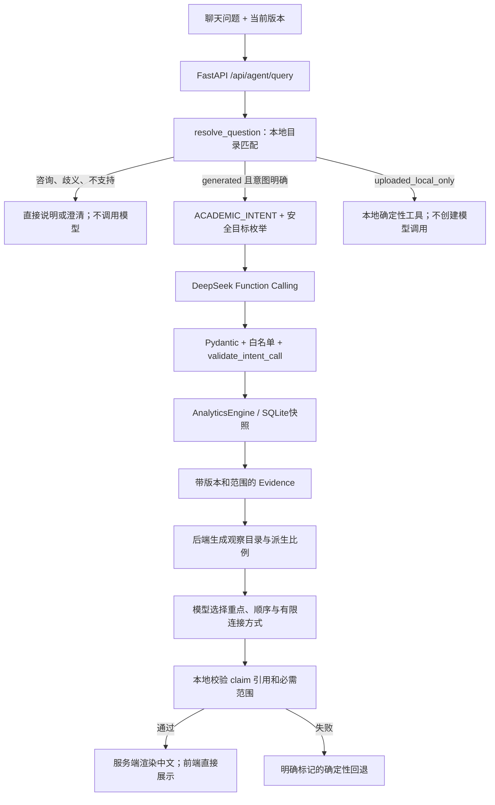

# Phase 3C：意图、证据分析与快照核对

本轮从 `f8526e5fd16e65b62ba22dfb5d404a114cf7b60a` 开始。目标是修复真实问题中的范围误判，并把已验证的分析展示到聊天页。没有更换框架、数据库或统计公式，没有执行本轮真实 DeepSeek 请求。

## 两个问题的实际诊断

使用服务器合成数据：seed=20261111、2024级软工、2班、每班6人、6课，2025–2026学年第一学期。隔离数据库、RecordingMock 记录实际传给 provider.complete 的消息；这不是对用户历史真实网络请求的抓包。

| 项目 | 案例 A：你知道针对体育课的成绩分析嘛 | 案例 B：分析体育 III 的成绩分布 |
|---|---|---|
| 原 resolve 状态 | ready | ready |
| 原工具 | get_score_summary | get_score_summary |
| 原 course_id | null | Id935981463527088a0808e1a |
| 其余参数 | term=2025-T1，class_id=null，grade_level=null | 同左 |
| 原样本 | 全部72条 | 体育 III 的12条 |
| 原均分 | 72.43 | 85.05 |
| 原 answer_mode / fallback_reason | grounded_narrative / null | grounded_narrative / null |
| 原 model_turns | 2，Mock | 2，Mock |

完整 `ResolvedIntent`、响应和每轮消息在交付包 `evidence/phase3c-baseline-diagnosis.json`。关键原因：

1. “成绩”命中了统计关键词；“体育课”没有命中目录里的完整名称“体育 III”。原来的课程澄清规则又没有覆盖这个说法，最终把空 course_id 解释为全体课程。
2. 模型只收到 system 消息、服务端生成的 `ACADEMIC_INTENT`，以及工具返回的 Evidence 和 narrative_slots，没有收到原始中文问题。原分析目标中的“成绩分布”也没有单独保留。
3. 后端 `render_narrative()` 的输出留在技术详情里；页面无条件执行 `_evidence_cn()`，因此正常模型输出也被重新写成固定的中文指标列表。只改提示词不能解决这一点。

现在 A 只返回能力说明，模型轮次为0、没有工具和 Evidence。泛指“分析体育课的成绩”返回目录候选，单候选也要求用户确认。B 保留原来的准确课程和12条证据；新协议有效时，页面显示受验证的中文分析，协议缺失或无效则明确回退。

## 最重要的调用链



Excel 导入链没有重写：`XLSX → parse_college_workbook → 五表 Dataset.validate → 事务 replace → AnalyticsEngine → Evidence → Streamlit`。空白不生成选课，0分保留，缺考/免修不进入有效成绩分母。统计仍按成绩记录计算，不是先算每个学生的均分再平均。

## 三处值得读懂的代码

### 1. 解析不是关键词命中后就执行

`agent/semantics.py` 先判断能力咨询，再匹配目录实体；明确但未解析的课程主语只能产生澄清，不能继承旧课程或变成 null。部分名称只用于提供候选，不是给模型自动选课的授权。

```python
return _result(catalog, "needs_clarification", message,
               scope=SessionScope(**{**values, "course_id": None}),
               choices=_course_choices(candidates or catalog.courses))
```

对软件工程学习而言，这个分支就是业务不变量：**未确认实体不能进入统计执行**。Pydantic 只能判断 course_id 的格式，无法判断它是否忠实于用户问题；后者必须由语义验证完成。

### 2. AI 解释和确定性计算分开

`agent/analysis.py` 从 Evidence 生成明确 claim，例如分布中最多的分段、80分及以上比例、有效样本数量、缺考/免修排除和样本局限。比例复用 `analytics.ratio()`；班级差值依据精确总分和记录数，仅在 compare_classes 证据存在时提供。

```json
{"kind":"observations","claim_ids":["r1.dominant_band","r1.high_band"],"style":"connected"}
```

模型选择目录中的观察和顺序，而不是自由填入事实文本或数值。服务器验证版本、引用、分类、必需范围与目标，再渲染中文。分布问题必须有真正的分布观察；没有成绩时只能使用“分布不可用”的说明。

当前样本可核对的观察：70–80分段5/12条，41.67%；80分及以上7/12条，58.33%。这些描述提供了均分以外的信息，但不能推出教师教学效果、学生动机或未来风险。

这是受限的证据组织与解释协议，**尚不是任意中文自由文本的真实性验证器**。这种取舍提高了可核验性，同时限制措辞自由度。默认 Mock 保留旧协议，因此会明确标记 missing_analysis 回退；专门的 ScriptedProvider 正例用于验证新链路，不冒充真实模型能力。

### 3. 下载读当前数据库，不重新生成

`data/synthetic_export.py` 中，来源检查、版本检查和五表读取位于同一 SQLite 读事务：

```python
connection.execute("BEGIN")
metadata = database.metadata(connection)
database.check_access(metadata, expected_version=expected_version, generated_only=True)
```

这解决了“检查时是合成数据、读表时已换成上传数据”的竞争条件。页面把读取操作作为 download_button 的延迟回调，每次点击重新验证，不把旧 XLSX 字节放进 Session State。

XLSX 含“成绩明细、课程目录、班级目录、学生目录、数据说明”。保存完整课程ID、学生内部别名、学期、原始百分之一分、版本、五表数量和口径。它导出当前数据库保存的别名，不伪造导入前已被移除的姓名/学号；也不是可直接重新导入的学院宽表。

## 演示和核对

离线启动：`scripts/start_backend.ps1 -Provider mock`，另开窗口运行 `scripts/start_dashboard.ps1`。明确选择合成数据、预览并确认后：

1. 问“你知道针对体育课的成绩分析嘛”：只有能力说明，无统计。
2. 问“分析体育课的成绩”：提示确认目录里的体育 III。
3. 问“分析体育 III 的成绩分布”：课程范围正确；默认 Mock 显示明确的确定性回退。新协议 ScriptedProvider 测试验证综合分析显示分支。
4. 点击“下载当前合成成绩单（XLSX）”：对照侧栏人数/课程数/成绩数和“数据说明”的版本。
5. 查看“计算证据与技术详情”：完整版本可以复制；课程ID对应关系在证据JSON及导出目录中。

真实 DeepSeek 的新协议适配、实际生成质量和费用均未在本轮验证；用户先前已做的真实测试不替代这一轮验证。未经新授权不得调用。

## 边界与后续

- 四个统计工具和确定性统计口径不变。专业筛选原有参数错配现已修复，仍复用 course_report。
- 没有 SSE。页面的等待反馈不是模型内部推理，也不是实时阶段事件。
- 聊天页每个问题独立解析；API 的已确认 SessionScope 可复用，尚无复杂多轮会话推理。
- 轻量规则可能对未覆盖表达继续要求澄清；它不保证理解所有中文。
- 受控规划仅设计与 Mock 验证，不接生产问答，不执行SQL/Python。见 PLANNING.zh-CN.md。
- 已下载文件无法撤回；旧页面按钮再次点击会重新检查服务端来源和版本。过期时 Streamlit 下载提示可能较笼统，需要刷新后重试。
- 原报告工作台与三种统计视图保留；没有新增 Word、RAG、多模型或运行时多Agent。

测试命令、实际结果、浏览器检查及每个改动文件见 FILES.md。完成的测试仅证明覆盖的用例，不等于真实模型或所有设备均已验收。
